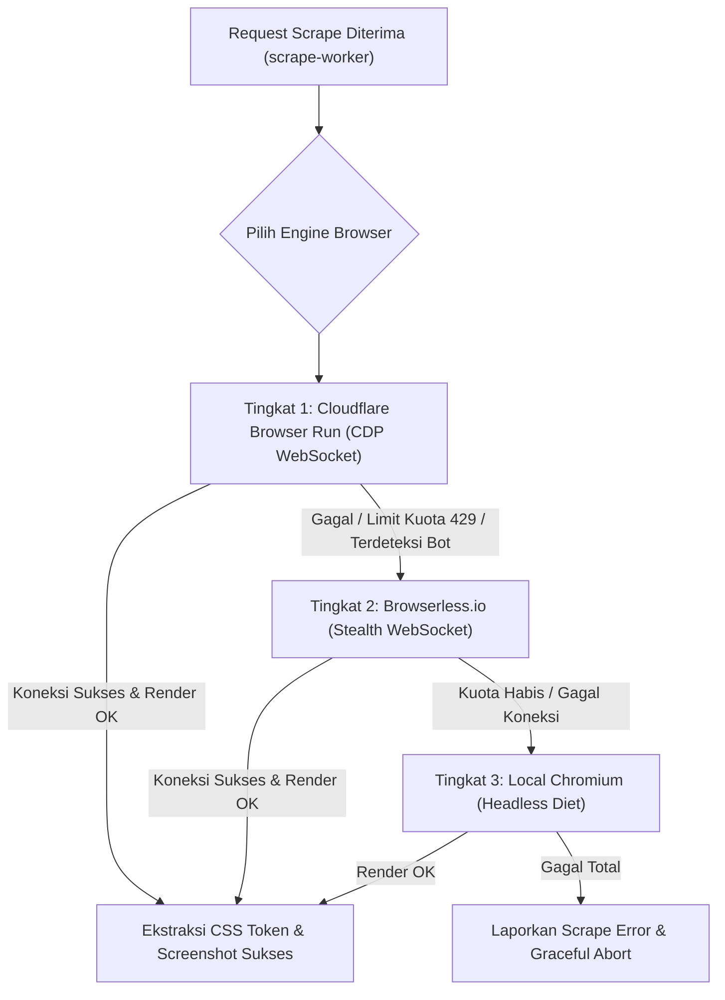
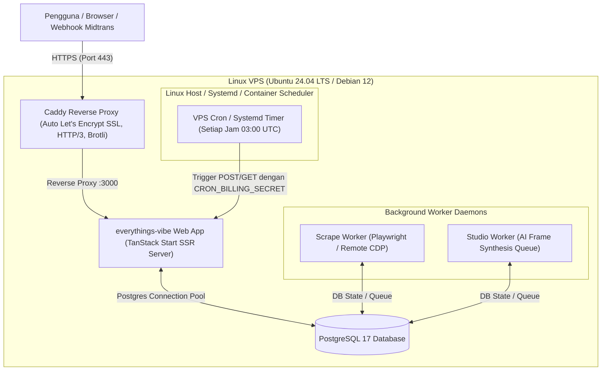

# everythings-vibe — Active Backlog

## Overview

Dokumen ini merupakan **backlog aktif tunggal (Single Source of Truth)** untuk pekerjaan yang **benar-benar belum selesai (unfinished work)** di repositori **everythings-vibe**. Seluruh inisiatif yang telah tuntas diimplementasikan dan diverifikasi telah diarsipkan keluar dari dokumen ini demi menjaga fokus dan kejelasan status backlog.

---

## 📌 Daftar Isi Backlog Aktif

- [1. Active Work](#1-active-work)
  - [Inisiatif 2: UI/UX Standarisasi — WAJIB Mobile & Tablet Responsive Seluruh Halaman](#inisiatif-2-uiux-standarisasi-wajib-mobile-tablet-responsive-seluruh-halaman)
  - [Inisiatif 3: Refactoring & Clean Code — Dekonstruksi Sisa Modul Melebihi Batas 400 Baris](#inisiatif-3-refactoring-clean-code-dekonstruksi-sisa-modul-melebihi-batas-400-baris)
  - [Inisiatif 11: Infra & Scraping Optimization — Hybrid Remote Browser (Cloudflare Browser Run & Browserless.io Fallback)](#inisiatif-11-infra-scraping-optimization-hybrid-remote-browser-cloudflare-browser-run-browserlessio-fallback)
  - [Inisiatif 12: Infra & Deployment Overhaul — Migrasi Total dari Vercel ke Self-Hosted VPS (Docker, Caddy & Zero Vercel)](#inisiatif-12-infra-deployment-overhaul-migrasi-total-dari-vercel-ke-self-hosted-vps-docker-caddy-zero-vercel)
- [2. Deferred Work](#2-deferred-work)
  - [Inisiatif 1: Architectural Backlog — Greenfield Workspace Routing Architecture Refactor](#inisiatif-1-architectural-backlog-greenfield-workspace-routing-architecture-refactor)
  - [Inisiatif 6: Runtime & Performance Optimization — Migrasi Node.js ke Bun](#inisiatif-6-runtime-performance-optimization-migrasi-nodejs-ke-bun)
- [3. Verification Notes & Known Blockers](#3-verification-notes-known-blockers)
  - [Blocker Rilis NPM Package CLI (@ghazynabiel/everythings-vibe)](#blocker-rilis-npm-package-cli-ghazynabieleverythings-vibe)
  - [Catatan Teknis & Debt Baseline](#catatan-teknis-debt-baseline)

---

## 1. Active Work

### Inisiatif 2: UI/UX Standarisasi — WAJIB Mobile & Tablet Responsive Seluruh Halaman

- **Status:** `Not Started`
- **Prioritas:** `P1`
- **Kompleksitas:** `Sedang - Luas` (Menyentuh seluruh surface aplikasi)
- **Tujuan:** Menjadikan seluruh antarmuka dan komponen UI responsif, nyaman disentuh (*touch-friendly*), dan bebas dari bug layout pada resolusi Mobile (360px – 640px) dan Tablet (641px – 1024px).

#### Prinsip & Standar Responsivitas (Definition of Done)

1. **Zero Horizontal Overflow:** Tidak ada elemen yang bocor ke kanan (`overflow-x: hidden` alami tanpa merusak scrolling konten utama).
2. **Breakpoints Standar:**
   - **Mobile:** 360px – 640px (`sm` breakpoint Tailwind).
   - **Tablet / Small Laptop:** 641px – 1024px (`md` & `lg` breakpoint).
   - **Desktop:** > 1024px (`xl` & `2xl`).
3. **Touch Targets Safe:** Semua button, icon button, dan trigger minimal memiliki ukuran interaktif 44x44px.
4. **Readable Typography:** Ukuran font dan line-height nyaman dibaca di layar kecil tanpa perlu zoom manual.
5. **Fluid Drawers & Bottom Sheets:** Sidebar/panel di desktop berubah menjadi collapsible bottom sheet atau off-canvas drawer di mobile.

#### Checklist Audit & Perbaikan per Halaman

##### A. Public & Marketing Pages

- [ ] **Landing Page (`src/routes/index.tsx`):**
  - [ ] Hero Section: Headline, CTA button, dan ilustrasi bento grid stack vertikal pada layar `< 768px`.
  - [ ] 4-Bento Navigation Hub (`src/components/home/bento-hub.tsx`): Grid bento 4-kolom beralih ke 1-kolom di mobile dan 2-kolom di tablet.
  - [ ] Interactive feature previews / showcase tidak meluap ke luar layar.
- [ ] **Pricing Page (`src/routes/pricing.tsx`):**
  - [ ] Pricing card grid berubah dari 3-kolom menjadi 1-kolom bersusun dengan kartu "Recommended" tetap kontras.
  - [ ] Tabel perbandingan fitur memiliki horizontal scroll indikator yang jelas atau accordion di mobile.
  - [ ] Tombol Checkout/Top-up mudah diakses (sticky bottom bar jika diperlukan).
- [ ] **About (`src/routes/about.tsx`) & FAQ (`src/routes/faq.tsx`):**
  - [ ] Padding container responsif (`px-4 sm:px-6 lg:px-8`).
  - [ ] Accordion item pada FAQ mudah ditekan dengan target sentuh lebar.
- [ ] **Templates Page (`src/routes/templates.tsx`):**
  - [ ] Filter tab / category pill dapat digeser horizontal secara halus (`flex overflow-x-auto no-scrollbar`).
  - [ ] Card template beralih ke layout 1-kolom (mobile) dan 2-kolom (tablet).
- [ ] **Bantuan & Feedback (`src/routes/bantuan.tsx`):**
  - [ ] Form input keluhan, file uploader screenshot, dan tombol kirim responsif penuh.
- [ ] **Auth, Login & Onboarding (`src/routes/login.tsx`, `src/routes/onboarding.tsx`):**
  - [ ] Card formulir login OAuth (Google & GitHub) berada tepat di tengah tanpa margin terpotong keyboard virtual mobile.
  - [ ] Step onboarding multi-step muat dengan rapi tanpa tertutup header browser HP.
- [ ] **Maintenance Page (`src/routes/maintenance.tsx`):**
  - [ ] Ilustrasi dan pesan status terpusat dan proporsional di seluruh ukuran layar.

##### B. Core Workspace & Flow Pages

- [ ] **Global Navbar & History Drawer (`src/components/layout/navbar.tsx`, `src/components/layout/history-drawer.tsx`):**
  - [ ] Hamburger icon responsif di pojok kiri atas untuk membuka History Drawer di mobile.
  - [ ] Logo dan status kredit tetap terbaca rapi; sisa kredit tidak berhimpitan dengan profile avatar.
  - [ ] Profile dropdown menu dan modal dialogs pas di dalam viewport HP.
- [ ] **History Page (`src/routes/history.tsx`, `src/components/history/history-page.tsx`):**
  - [ ] Daftar project card tersusun rapi dengan badge status yang tidak wrap semrawut.
  - [ ] Search input dan filter dropdown mudah diakses di layar sempit.
- [ ] **Plan Hub (`src/routes/plan/index.tsx`, `src/routes/plan/new.tsx`, `src/routes/plan/codebase.tsx`):**
  - [ ] Pilihan mode workspace ("Greenfield New Project" vs "Existing Codebase") stack vertikal di mobile.
  - [ ] Form input ide / deskripsi proyek memenuhi lebar layar dengan padding yang proporsional.
  - [ ] CLI sync instruction box di `/plan/codebase` memiliki copy-to-clipboard button yang nyaman dan text block `overflow-x-auto`.
- [ ] **Guided Questions (`src/routes/ask/$id.tsx`):**
  - [ ] Question cards dan multiple-choice options mudah dipilih via sentuhan jari (min 44px tinggi tap).
  - [ ] Textarea untuk custom answer tidak tertutup oleh tombol navigasi "Next / Generate".
  - [ ] Progress indicator pertanyaan di atas terlihat jelas dan tidak gepeng di tablet/HP.
- [ ] **Feature Tree Diagram (`src/routes/fitur/$id.tsx`):**
  - [ ] Canvas diagram pohon fitur (`src/features/greenfield/components/feature-tree/feature-map-canvas.tsx`) mendukung gesture pan (geser layar) dan zoom in/out di mobile/tablet.
  - [ ] Floating action toolbar (Zoom, Reset, Download, Continue) tidak menutupi diagram utama di mobile.
- [ ] **PRD Viewer & AI Revision Chat (`src/routes/prd/$id.tsx`):**
  - [ ] Dual-panel (PRD Document di kiri + Chat Panel di kanan) berubah menjadi tabbed view atau toggle sheet di mobile (`< 1024px`).
  - [ ] Markdown PRD rendered table memiliki wrapper `overflow-x-auto` agar tabel spesifikasi tidak memotong halaman.
  - [ ] Mermaid diagram di dalam PRD otomatis scale atau menyediakan zoom modal jika diagram terlalu lebar.
  - [ ] Chat panel bubble input tidak tertutup virtual keyboard mobile.
- [ ] **PRD Public Share (`src/routes/prd/share/$token.tsx`):**
  - [ ] View publik PRD bebas gangguan pada browser mobile; tombol export/copy link tetap accessible.
- [ ] **Acceptance Criteria (`src/routes/ac/$id.tsx`):**
  - [ ] Daftar AC dan scenario Gherkin (Given-When-Then) ter-render rapi tanpa text clipping.
  - [ ] Tombol edit / regenerate / accept criteria responsif dan tidak tumpang tindih.
- [ ] **Task Breakdown Whiteboard Canvas (`src/routes/task/$id.tsx`):**
  - [ ] `WhiteboardCanvas` (`src/features/greenfield/components/whiteboard/whiteboard-canvas.tsx`) mendukung viewport touch / drag canvas di tablet dan ponsel.
  - [ ] Task card hierarchy node tidak berantakan saat resolusi layar berubah.
  - [ ] Mode list alternatif (opsional jika canvas terlalu padat untuk layar 360px HP) agar pengguna tetap bisa membaca task tree.
- [ ] **Interactive Kanban Board (`src/routes/kanban/$id.tsx`):**
  - [ ] Kolom Kanban (To Do, In Progress, Done, etc.) dapat di-scroll horizontal secara halus (`flex gap-4 overflow-x-auto snap-x`).
  - [ ] Drag-and-drop task card kompatibel dengan sentuhan layar (touch dnd fallback atau action menu pindah status).
  - [ ] Modal detail card kanban muat penuh di layar HP (full-screen modal atau bottom sheet).
- [ ] **Codebase Workspace (`src/routes/codebases/index.tsx`, `src/routes/codebases/$id.tsx`):**
  - [ ] Dual/Triple pane (Explorer sidebar + Canvas/Doc Preview + Chat) beralih menjadi navigation tab atau drawer switch di mobile/tablet.
  - [ ] Terminal sync command prompt box tidak membuat horizontal overflow di HP.

##### C. VibeScrape & VibeDesign Studio Pages

- [ ] **VibeScrape Workspace (`src/routes/scrape/index.tsx`, `$id.tsx`, `history.tsx`):**
  - [ ] Form input URL scrape, status progress bar, parameter tuning, dan extraction error card tampil rapi di mobile tanpa horizontal overflow.
  - [ ] Tampilan hasil ekstraksi `DESIGN.md`, inspeksi color token swatch, dan asset gallery adaptif di mobile/tablet.
- [ ] **VibeDesign Studio (`src/routes/design/index.tsx` & `$id.tsx`):**
  - [ ] Layout editor desain responsif: panel tools, multi-screen canvas preview, dan inspect panel beradaptasi pada viewport tablet.
  - [ ] Di layar mobile, berikan tampilan preview yang optimal atau notifikasi visual bahwa mode canvas editing lebih disarankan di tablet/desktop.

##### D. Settings & Admin Dashboard

- [ ] **Settings Pages (`src/routes/settings/*`):**
  - [ ] Sidebar navigasi Settings (`profile.tsx`, `account.tsx`, `billing.tsx`, `api-keys.tsx`, `notifications.tsx`, `feedback.tsx`) berubah menjadi horizontal tab atau dropdown select di mobile.
  - [ ] Tabel riwayat transaksi invoice Midtrans di `billing.tsx` responsif dengan card list fallback di mobile.
- [ ] **Admin Dashboard (`src/routes/admin/*`):**
  - [ ] Metric cards di `admin/index.tsx` stack menjadi 1 kolom (mobile) dan 2 kolom (tablet).
  - [ ] Tabel pengguna, proyek, feedback, dan transaksi menggunakan responsive table layout (card view pada viewport kecil).

---

### Inisiatif 3: Refactoring & Clean Code — Dekonstruksi Sisa Modul Melebihi Batas 400 Baris

- **Status:** `In Progress`
- **Prioritas:** `P2`
- **Kompleksitas:** `Rendah - Sedang`
- **Tujuan:** Menyelesaikan pembersihan modularitas dengan mendekonstruksi file-file implementasi produksi yang masih melampaui batas keras 400 baris kode per file (`anti-monster ceiling` pada `.agents/rules/architecture-folder-structure.md`).

#### Hasil Audit Dekonstruksi File Monster Historis (Terverifikasi Selesai)

File monster historis dari fase awal telah berhasil didekonstruksi sepenuhnya:
- `src/routes/codebases/$id.tsx` (1.835 baris $\rightarrow$ **69 baris**, thin route).
- `src/lib/codebase-sync.ts` (1.582 baris $\rightarrow$ didekonstruksi ke modul-modul modular di `src/features/codebase/services/`).
- `src/components/task/whiteboard-canvas.tsx` (1.349 baris $\rightarrow$ `src/features/greenfield/components/whiteboard/whiteboard-canvas.tsx`, **235 baris**).
- `src/components/chat/chat-panel.tsx` (1.183 baris $\rightarrow$ `src/features/greenfield/components/chat/chat-panel.tsx`, **149 baris**).
- `src/lib/services/credit-service.ts` (1.256 baris $\rightarrow$ facade **52 baris**, domain services di `src/features/billing/services/credit/`).
- `src/db/schema.ts` (1.391 baris $\rightarrow$ facade **7 baris**, modul domain di `src/db/schema/`).
- `src/components/layout/navbar.tsx` (771 baris $\rightarrow$ **359 baris**).

#### Sisa File Melebihi Batas 400 Baris (Target Refactor Aktif)

Berdasarkan audit riil codebase setelah refactor credit modal (per Oktober 2026), tersisa 1 file implementasi produksi yang melebihi batas 400 baris. `src/routeTree.gen.ts` dikecualikan karena generated source.

1. **`src/components/ui/thought-line.tsx` (548 baris $\rightarrow$ 142 baris):** $\checkmark$ Selesai 2026-10-25.
   - Menampung visualisasi stream reasoning AI, animasi pulse, expand/collapse state, markdown typewriter, dan telemetry.
   - [x] Ekstraksi renderer animasi dan collapsible header ke sub-komponen terpisah di `src/components/ui/thought-line/` (`thought-line-header.tsx`, `thought-line-trace.tsx`).
   - [x] Ekstraksi kalkulasi step timing ke custom hook `use-thought-stream.ts`, plus `thought-line-timing.ts` dan `thought-line-types.ts`.
   - [x] Ringankan `thought-line.tsx` hingga $\le$ 300 baris.

2. **`src/features/billing/components/credit-exhausted-modal.tsx` (408 baris $\rightarrow$ 226 baris):** $\checkmark$ Selesai 2026-10-26.
   - Menampung dialog penolakan kredit habis, kalkulasi selisih top-up, pemilihan paket kredit Midtrans, trigger checkout Snap, dan fallback manual transfer.
   - [x] Ekstraksi paket selector card list ke `src/features/billing/components/credit-package-radio-group.tsx` (102 baris, radio native + navigasi panah keyboard + radiogroup semantics).
   - [x] Ekstraksi payment flow trigger ke hook `src/features/billing/hooks/use-credit-topup-dialog.ts` (146 baris, termasuk guard submit ganda).
   - [x] Ekstraksi header dialog (close, ikon, judul, error, ringkasan kredit) ke `src/features/billing/components/credit-exhausted-modal-header.tsx` (97 baris).
   - [x] Ringankan file modal menjadi orchestrator tipis $\le$ 250 baris (226 baris).
   - Catatan: kontrak `POST /api/payments/create` (`planId`, `returnUrl`, `projectId`), resume-intent, aturan eligibility, dan redirect tidak berubah. Test `credit-exhausted-modal.test.tsx` diperluas menjadi 21 kasus.

3. **`src/features/codebase/components/planning/codebase-resync-modal.tsx` (467 baris):** Belum selesai.
   - Menampung step indicator 3 langkah, blok salin prompt re-sync, monitoring status snapshot, dan footer verifikasi.
   - [ ] Ekstraksi step indicator dan blok "Salin instruksi" ke sub-komponen terpisah.
   - [ ] Ringankan file modal hingga $\le$ 400 baris.

#### Acceptance Criteria Refactor

- [ ] Seluruh file kode produksi di bawah `src/` berukuran $\le$ 400 baris. Tersisa `codebase-resync-modal.tsx` (467 baris); `routeTree.gen.ts` dikecualikan sebagai generated source.
- [x] Nol type bypass (`as any`, `as never`, `@ts-ignore` dilarang per `no-type-bypass.md`): terverifikasi nol pada source produksi authored.
- [ ] Seluruh test suite Vitest tetap hijau tanpa pelunakan assertions. 5259 lulus, 3 gagal pre-existing di luar scope refactor: `agent-thinking.test.tsx` (timeout), `scrap.$id.test.tsx` (timeout), dan `payment-service.test.ts` (membaca facade `src/db/schema.ts` yang sudah dimodularisasi; tabel `payments`/`subscriptions` kini di `src/db/schema/billing.ts`).

---

### Inisiatif 11: Infra & Scraping Optimization — Hybrid Remote Browser (Cloudflare Browser Run & Browserless.io Fallback)

- **Status:** `Not Started`
- **Prioritas:** `P1` (Kritis untuk Menghindari Linux OOM Killer pada VPS RAM 2–4 GB)
- **Kompleksitas:** `Sedang`
- **Tujuan:** Mendelegasikan komputasi berat rendering headless Chromium dari VPS lokal ke remote CDP WebSocket pool (Cloudflare Browser Run + Browserless.io stealth fallback), memangkas konsumsi RAM scraping worker dari ~800 MB menjadi ~10–20 MB.

#### Arsitektur Failover Bertingkat



#### Desain Teknis Browser Session Pool

Modul: `src/features/scrape/services/browser-session.ts`

```typescript
export async function getResilientBrowser(): Promise<Browser> {
  // 1. Coba Cloudflare Browser Run (Free: 10 menit/hari, ultra-cepat)
  if (env.CF_ACCOUNT_ID && env.CF_API_TOKEN) {
    try {
      const cfWss = `wss://api.cloudflare.com/client/v4/accounts/${env.CF_ACCOUNT_ID}/browser-run/devtools/browser`;
      return await chromium.connectOverCDP(cfWss, {
        headers: { Authorization: `Bearer ${env.CF_API_TOKEN}` },
        timeout: 12_000,
      });
    } catch (cfErr) {
      console.warn("[Scrape Worker] Cloudflare Browser Run gagal atau limit harian habis, failover ke Browserless...", cfErr);
    }
  }

  // 2. Coba Browserless.io Stealth (Free: 1.000 unit/bulan, anti-bot bypass)
  if (env.BROWSERLESS_API_KEY) {
    try {
      const blWss = `wss://chrome.browserless.io?token=${env.BROWSERLESS_API_KEY}&stealth`;
      return await chromium.connect(blWss, { timeout: 12_000 });
    } catch (blErr) {
      console.warn("[Scrape Worker] Browserless gagal atau limit bulanan habis, failover ke Local Chromium...", blErr);
    }
  }

  // 3. Fallback Darurat: Chromium Lokal (dengan flag diet ketat)
  return await chromium.launch({
    headless: true,
    args: [
      "--no-sandbox",
      "--disable-dev-shm-usage",
      "--disable-gpu",
      "--disable-software-rasterizer",
      "--no-zygote",
      "--disable-extensions",
      "--disable-background-networking",
      '--js-flags="--max-old-space-size=256"',
    ],
  });
}
```

#### Checklist Eksekusi Bertahap

- [ ] **Fase 1 — Abstraksi Provider Remote:** Buat modul adapter koneksi remote (`cloudflare-browser-provider.ts` & `browserless-provider.ts`).
- [ ] **Fase 2 — Integrasi Failover Logic:** Terapkan logika failover berantai di `src/features/scrape/services/browser-session.ts` dengan penanganan timeout dan HTTP 429.
- [ ] **Fase 3 — Diet Flag Chromium Lokal:** Perbarui argumen `chromium.launch()` cadangan dengan flag penghemat memori (`--no-zygote`, `--disable-gpu`, heap limit 256MB).
- [ ] **Fase 4 — Environment & Validasi Skema:** Tambahkan variabel lingkungan (`CF_ACCOUNT_ID`, `CF_API_TOKEN`, `BROWSERLESS_API_KEY`, `SCRAPE_BROWSER_MODE`) ke schema Zod environment dan dokumentasikan di `.env.example`.
- [ ] **Fase 5 — Unit & Integration Testing:** Buat test mock untuk memverifikasi bahwa failover terpanggil saat provider pertama melempar error koneksi atau timeout.
- [ ] **Fase 6 — Verifikasi Real-World Scrape:** Uji ekstraksi live website publik via remote Cloudflare & Browserless, pastikan screenshot dan `visualEvidence` terekstraksi presisi.

---

### Inisiatif 12: Infra & Deployment Overhaul — Migrasi Total dari Vercel ke Self-Hosted VPS (Docker, Caddy & Zero Vercel)

- **Status:** `Not Started`
- **Prioritas:** `P1` (Kritis untuk Mengeliminasi Serverless Timeout & Vendor Lock-In)
- **Kompleksitas:** `Sedang - Tinggi`
- **Tujuan:** Mengeliminasi ketergantungan pada Vercel secara 100%, menghapus seluruh artefak Vercel (`vercel.json`, Vercel Cron, env hacks), dan memigrasikan web TanStack Start SSR, Playwright Scrape Worker, Studio Worker, dan billing cron ke VPS Linux mandiri berbasis Docker Compose dan reverse proxy Caddy (automatic SSL Let's Encrypt).

#### Target Arsitektur VPS



#### Checklist Eksekusi Bertahap

- [ ] **Fase 1 — Docker Packaging:** Buat multi-stage `Dockerfile` (Node 22, pnpm, build output `.output/server/index.mjs`) dan `docker-compose.yml` untuk web app dan worker daemons. Uji build lokal hingga lolos tanpa error.
- [ ] **Fase 2 — Transisi Cron Billing:**
  - [x] Buat skrip cron mandiri provider-independent (`scripts/run-billing-cron.ts`, `pnpm cron:billing`) dengan timeout handling, zero-secret-leakage logging, dan dokumentasi host scheduler (`docs/deployment/billing-scheduler.md`).
  - [ ] Aktivasi live scheduler / systemd timer pada host VPS (tertunda hingga VPS diprovisioning).
- [x] **Fase 3 — Eliminasi Total Konfigurasi Vercel:**
  - [x] Hapus permanen `vercel.json` dari root repositori.
  - [x] Hapus fallback ke `process.env.CRON_SECRET` di `src/features/billing/services/billing-cron.server.ts` (gunakan hanya `CRON_BILLING_SECRET`).
  - [x] Sanitasi instruksi dan referensi Vercel di `.env.example` dan dokumentasi teknis.
- [ ] **Fase 4 — Konfigurasi VPS & Reverse Proxy Caddy:** Siapkan instance VPS (Ubuntu/Debian), konfigurasi firewall (UFW 80, 443, 22), dan siapkan `Caddyfile` dengan automatic HTTPS Let's Encrypt, HTTP/3, dan reverse proxy ke port 3000.
- [ ] **Fase 5 — Pipeline CI/CD:** Buat workflow GitHub Actions (`.github/workflows/deploy.yml`) untuk auto-deploy via SSH ke VPS saat push ke branch `main`.
- [ ] **Fase 6 — Cutover & Verifikasi Live:** Arahkan DNS domain utama ke IP VPS, verifikasi sertifikat SSL otomatis, uji Better Auth login, Midtrans webhook callback, dan background workers.

---

## 2. Deferred Work

### Inisiatif 1: Architectural Backlog — Greenfield Workspace Routing Architecture Refactor

- **Status:** `Proposed / Deferred`
- **Prioritas:** `P3`
- **Kompleksitas:** `Tinggi`
- **Inisiator:** Product & UX Alignment
- **Deskripsi:** Menyatukan alur Greenfield yang saat ini berpindah-pindah rute (`/ask/:id`, `/fitur/:id`, `/prd/:id`, `/ac/:id`, `/task/:id`, `/kanban/:id`) ke dalam satu shell workspace yang konsisten (`/vibeplan/:id`) tanpa kesan "pindah-pindah website".

#### Opsi Solusi yang Dievaluasi

##### Opsi 1: Search-Param-Driven State Routing (Wizard Single-Route)
- **Format URL:** `/vibeplan/:id?step=question` $\rightarrow$ `?step=fitur` $\rightarrow$ `?step=prd` $\rightarrow$ `?step=ac` $\rightarrow$ `?step=task` $\rightarrow$ `?step=kanban`
- **Kelebihan:** Persistent shell layout (Navbar, SSE stream, project header) tidak pernah re-mount; sharing state lokal antar step lebih mulus.
- **Tantangan:** Membutuhkan dynamic code-splitting `lazy()` granular agar tidak mendownload seluruh view sekaligus.

##### Opsi 2: Nested Layout Routes (Pola Standar Industri / Sub-Routes)
- **Format URL:** `/vibeplan/:id/ask`, `/vibeplan/:id/fitur`, `/vibeplan/:id/prd`, `/vibeplan/:id/ac`, `/vibeplan/:id/task`, `/vibeplan/:id/kanban`
- **Kelebihan:** Granular loader bawaan TanStack Start per child route, URL sangat deskriptif dan mudah di-bookmark.

#### Lingkup Perubahan & Dampak (Impact Assessment)
1. Penataan ulang file di `src/routes/`.
2. Penyesuaian `stepToRoute` & `stepToRouteTarget` di `src/features/greenfield/utils/flow-step.ts`.
3. Link resume riwayat di `src/components/history/history-page.tsx` dan `src/components/layout/history-drawer.tsx`.
4. Callback login / onboarding redirect targets.
5. Pembaruan assertions rute di test suite.

#### Milestone Eksekusi (Ketika Dijadwalkan)
- [ ] **Fase 1 — Desain Spesifikasi:** Putuskan Opsi 1 vs Opsi 2.
- [ ] **Fase 2 — Layout Shell Prototype:** Buat parent layout `/vibeplan/$id` dengan shared header & step indicator.
- [ ] **Fase 3 — Migrasi View Anak:** Pindahkan implementasi Ask, Fitur, PRD, AC, Task, dan Kanban ke dalam outlet/switcher baru.
- [ ] **Fase 4 — Router Redirects:** Tambahkan backward-compatibility redirect dari `/ask/:id`, `/prd/:id`, dll. ke rute baru.
- [ ] **Fase 5 — Verifikasi & Test Suite:** Update dan jalankan seluruh suite `pnpm check` dan `pnpm test`.
- [ ] **Fase 6 — Input PRD:** Pastikan alur input PRD ikut migrasi tanpa kehilangan state.
- [ ] **Fase 7 — Skill Compliance:** Pastikan skills relevan diterapkan saat eksekusi.

---

### Inisiatif 6: Runtime & Performance Optimization — Migrasi Node.js ke Bun

- **Status:** `Proposed / Deferred`
- **Prioritas:** `P2`
- **Kompleksitas:** `Tinggi`
- **Tujuan:** Mengevaluasi Bun (v1.2+) sebagai runtime engine dan package manager pengganti Node.js untuk meningkatkan kecepatan cold start, performa event loop, efisiensi memori (RAM), dan kecepatan instalasi dependensi, apabila terbukti unggul secara terukur.

> **PENTING — BATASAN ARSITEKTUR:**  
> **TanStack Start TETAP menjadi full-stack web framework utama.** Bun hanya dievaluasi sebagai host eksekusi proses server, BUKAN untuk menulis ulang backend menggunakan framework lain (Elysia/Hono). Seluruh server functions (`createServerFn`), middleware, dan SSR streaming TanStack Start dipertahankan.

#### Target Arsitektur (Bila Lolos Evaluasi)
- Runtime: Bun v1.2+ host eksekusi server development dan production.
- Package Manager: Bun install dengan dukungan workspace untuk `packages/cli`.
- Database Driver: `node-postgres` Pool di bawah compatibility layer Bun atau native Postgres adapter.
- CLI Companion: `packages/cli` tetap berkemampuan ganda (kompatibel dijalankan di Node.js maupun Bun di mesin pengguna).

#### Checklist Audit Kompatibilitas Runtime
- [ ] **Audit Referensi Node.js:** Periksa `node:child_process`, `node:worker_threads`, `node:crypto`, `node:net`, dan `node:dns/promises` (SSRF validator) di bawah Bun.
- [ ] **TanStack Start & Vite Compatibility:** Uji handler SSR TanStack Start dan build Vite 8 di bawah Bun.
- [ ] **Database & Atomic Locks:** Pastikan transaksi atomic credit (`WHERE credits_used + :charge <= credits`) dan tenant queries (`WHERE user_id = ?`) bebas race condition di Bun.
- [ ] **Better Auth & AI Stream:** Uji OAuth callback cookie handling, SSE stream typewriter, dan abort controllers.
- [ ] **Playwright Scrape Worker:** Uji kestabilan child process Chromium di bawah Bun.

#### Milestone Eksekusi (Ketika Dijadwalkan)
- [ ] **Milestone 1 — Baseline Benchmark:** Catat metrik Node.js (cold start, TTFB, memory footprint, build time).
- [ ] **Milestone 2 — Compatibility Assessment:** Sandbox testing dependensi inti di runtime Bun.
- [ ] **Milestone 3 — Package Manager Evaluation:** Uji `bun install` vs `pnpm` pada workspace monorepo.
- [ ] **Milestone 4 — Local Dev & Test Integration:** Jalankan dev server dan Vitest di bawah Bun (target 100% green).
- [ ] **Milestone 5 — Production Simulation:** Stress testing konkurensi (10, 50, 100 concurrent requests).
- [ ] **Milestone 6 — E2E Workflow Validation:** Verifikasi manual alur kritis (VibePlan, VibeDesign, CLI Sync, Billing).
- [ ] **Milestone 7 — Deployment & Rollback SOP:** Dokumentasikan prosedur fallback instan ke Node.js jika terjadi regresi.

#### Syarat Kelolosan Migrasi
- Zero functional regression pada auth, tenant isolation, dan billing atomicity.
- Peningkatan terukur pada TTFB, build time, atau RAM footprint tanpa menaikkan error rate.
- Jika Bun tidak menunjukkan keunggulan signifikan, **Node.js tetap dipertahankan sebagai runtime standar**.

---

## 3. Verification Notes & Known Blockers

### Blocker Rilis NPM Package CLI (@ghazynabiel/everythings-vibe)

- **Status:** `Blocked (Awaiting Automated Release Pipeline / Owner Credentials)`
- **Bukti & Temuan:**
  - Nama package di `packages/cli/package.json` telah diperbarui ke `@ghazynabiel/everythings-vibe` dengan executable kanonik `everythings-vibe` dan binary aliases (`vibeeverything`, `vibe`, `prdfy`).
  - Seluruh referensi perintah terminal di SaaS (`sync-commands.ts`, `sync-prompts.ts`, `implementation-options.tsx`) telah dimigrasikan ke `everythings-vibe`.
  - Namun, package tersebut **belum dipublikasikan ke registry publik npm** (`registry.npmjs.org`) karena tidak ada kredensial publikasi npm (`NPM_TOKEN`) atau workflow rilis CI otomatis yang disetup pada task sebelumnya.
- **Alasan Mencegah Penyelesaian Penuh:** Pengguna di luar repositori yang menjalankan `npm i -g @ghazynabiel/everythings-vibe` akan menemui error 404 dari npm sampai package resmi pertama kali di-publish.
- **Tindakan Konkret Berikutnya:**
  1. Siapkan workflow GitHub Actions `.github/workflows/release-cli.yml` dengan secret `NPM_TOKEN` yang sah milik repositori owner.
  2. Jalankan `pnpm --filter @ghazynabiel/everythings-vibe publish --access public` untuk merilis versi awal ke registry npm.
- **Source Paths Terkait:** `packages/cli/package.json`, `packages/cli/src/index.ts`, `.github/workflows/`.

### Catatan Teknis & Debt Baseline

1. **Dead Code Audit Findings (Knip):**
   - Skrip audit `pnpm run audit:deadcode` (`knip`) aktif dan berfungsi. Ditemukan 215 unused exports dan 164 unused types (sebagian besar berupa interface DTO, konstanta boundary, atau facade backward-compatibility seperti `EverythingsVibeMark | VibeEverythingMark` di `logo.tsx`).
   - Tindakan: Dapat dibersihkan bertahap saat refactoring domain terkait tanpa merusak backward compatibility.

2. **Pre-existing CSS Warnings:**
   - `npx @biomejs/biome check` menghasilkan 10 warning `noImportantStyles` pada `src/app/globals.css` (pre-existing baseline, tidak mempengaruhi kestabilan build).

3. **Client Build Externalization Warning:**
   - `vite build` menghasilkan 23 peringatan externalization modul `pg` pada bundle client (pre-existing baseline yang aman karena driver Postgres hanya dieksekusi di server functions).
