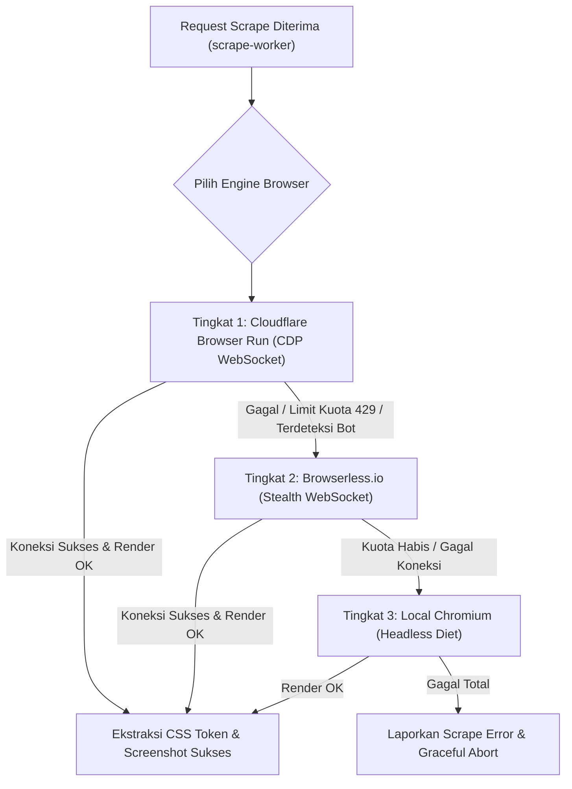
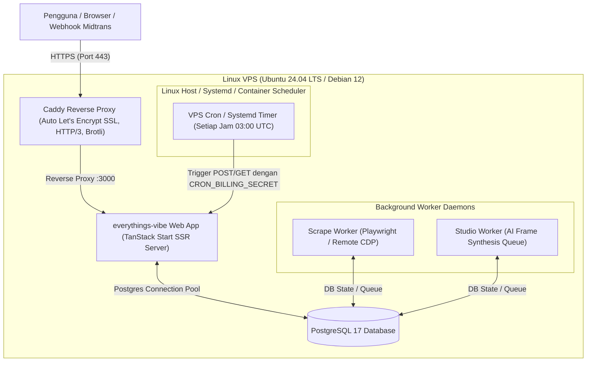

# everythings-vibe — Backlog &amp; Roadmap (TODO)

Dokumen ini memuat daftar rencana kerja, backlog arsitektur, standarisasi kualitas, refaktor teknis, dan pembersihan sistem untuk repositori **everythings-vibe**.

---

## 📌 DAFTAR ISI BACKLOG

1. [Bagian 1: Architectural Backlog — Greenfield Workspace Routing Architecture Refactor](#1-architectural-backlog--greenfield-workspace-routing-architecture-refactor)
2. [Bagian 2: UI/UX Standarisasi — WAJIB Mobile &amp; Tablet Responsive Seluruh Halaman](#2-uiux-standarisasi--wajib-mobile--tablet-responsive-seluruh-halaman)
3. [Bagian 3: Refactoring &amp; Clean Code — Dekonstruksi File Monster (~2.000 Baris) &amp; Reusable Architecture](#3-refactoring--clean-code--dekonstruksi-file-monster-2000-baris--reusable-architecture)
4. [Bagian 4: Dead Code Elimination — Pembersihan Total Deathcode, File/Folder Sampah &amp; Unused Dependencies](#4-dead-code-elimination--pembersihan-total-deathcode-filefolder-sampah--unused-dependencies)
5. [Bagian 5: Rebranding Ecosystem — Migrasi Menyeluruh dari VibeEverything ke everythings-vibe](#5-rebranding-ecosystem--migrasi-menyeluruh-dari-vibeeverything-ke-everythings-vibe)
6. [Bagian 6: Runtime &amp; Performance Optimization — Migrasi Node.js ke Bun](#6-runtime--performance-optimization--migrasi-nodejs-ke-bun)
7. [Bagian 7: Arsitektur Berbasis Fitur — Modular Feature-Driven Directory Structure](#7-arsitektur-berbasis-fitur--modular-feature-driven-directory-structure)
8. [Bagian 8: Aturan Tegas AI Agent — Enforcement Policy: Anti-Slop, Strict Structure &amp; Zero Dead Code](#8-aturan-tegas-ai-agent--enforcement-policy-anti-slop-strict-structure--zero-dead-code)
9. [Bagian 9: Decoupling &amp; Standalone Domain — Pemisahan VibeScrape dari VibeDesign](#9-decoupling--standalone-domain--pemisahan-vibescrape-dari-vibedesign)
10. [Bagian 10: Design System &amp; Iconography Overhaul — Migrasi dari Lucide React ke Hugeicons](#10-design-system--iconography-overhaul--migrasi-dari-lucide-react-ke-hugeicons)
11. [Bagian 11: Infra &amp; Scraping Optimization — Hybrid Remote Browser (Cloudflare Browser Run &amp; Browserless.io Fallback)](#11-infra--scraping-optimization--hybrid-remote-browser-cloudflare-browser-run--browserlessio-fallback)
12. [Bagian 12: Infra &amp; Deployment Overhaul — Migrasi Total dari Vercel ke Self-Hosted VPS (Docker, Caddy &amp; Zero Vercel)](#12-infra--deployment-overhaul--migrasi-total-dari-vercel-ke-self-hosted-vps-docker-caddy--zero-vercel)

---

## 1. Architectural Backlog — Greenfield Workspace Routing Architecture Refactor

### 1.1. Ringkasan Ide &amp; Kebutuhan

- **Status:** `Proposed / Backlog`
- **Inisiator:** Product &amp; UX Alignment
- **Deskripsi:** Saat ini alur Greenfield berpindah-pindah rute menggunakan path mandiri terpisah:
  - `/ask/:id` (Guided Questions)
  - `/fitur/:id` (Feature &amp; Subfeature Tree Diagram)
  - `/prd/:id` (8-Section PRD &amp; AI Revision Chat)
  - `/ac/:id` (Acceptance Criteria)
  - `/task/:id` (Whiteboard Task Breakdown)
  - `/kanban/:id` (Interactive Kanban Board)
- **Tujuan Refactor:** Menyatukan pengalaman pengguna agar berada di dalam satu shell workspace yang konsisten dan mulus, tanpa kesan "pindah-pindah website".

---

### 1.2. Evaluasi Opsi Solusi

#### Opsi 1: Search-Param-Driven State Routing (Wizard Single-Route)

- **Format URL:** `/vibeplan/:id?step=question` $\rightarrow$ `?step=fitur` $\rightarrow$ `?step=prd` $\rightarrow$ `?step=ac` $\rightarrow$ `?step=task` $\rightarrow$ `?step=kanban`
- **Mekanisme:**
  - Route tunggal di TanStack Router: `src/routes/vibeplan/$id.tsx` (atau `/plan/$id.tsx`).
  - Search param schema Zod:
    ```typescript
    const planSearchSchema = z.object({
      step: z.enum(["question", "fitur", "prd", "ac", "task", "kanban"]).default("question"),
    });
    ```
  - Navigasi antar step menggunakan `navigate({ search: { step: "fitur" } })`.
- **Kelebihan:**
  - Shell workspace (Navbar, project title, persistent websocket/SSE) tidak pernah re-mount.
  - State lokal antar tahap awal lebih mudah di-share di level parent.
  - Browser Back &amp; Forward otomatis mengontrol parameter `step`.
- **Tantangan Teknis:**
  - Wajib menerapkan code-splitting / dynamic `lazy()` imports pada level view komponen agar bundle PRD editor, whiteboard canvas, dan kanban drag-and-drop tidak di-download sekaligus di awal.
  - Data loading harus menggunakan granular TanStack Query di komponen anak, bukan monolithic loader di parent.

#### Opsi 2: Nested Layout Routes (Pola Standar Industri / Sub-Routes)

- **Format URL:**
  - `/vibeplan/:id/ask`
  - `/vibeplan/:id/fitur`
  - `/vibeplan/:id/prd`
  - `/vibeplan/:id/ac`
  - `/vibeplan/:id/task`
  - `/vibeplan/:id/kanban`
- **Mekanisme:**
  - Parent layout: `src/routes/vibeplan/$id.tsx` dengan `<Outlet />`.
  - Child routes di dalam `src/routes/vibeplan/$id/`.
- **Kelebihan:**
  - Tetap memiliki satu parent persistent workspace layout.
  - Menjaga granular loader per child route secara otomatis bawaan TanStack Start.
  - Code-splitting native per file route tetap optimal tanpa manual wrapper.
  - URL tetap sangat deskriptif dan mudah di-bookmark / di-share.

---

### 1.3. Lingkup Perubahan &amp; Dampak (Impact Assessment)

Jika refactor ini dieksekusi di masa mendatang, area berikut wajib diperbarui:

1. **Routing Files:** Penataan ulang file di `src/routes/`.
2. **Step Mapping Helper:** Penyesuaian `stepToRoute` &amp; `stepToRouteTarget` di `src/lib/flow-step.ts`.
3. **Card History &amp; Deep Linking:** Link resume di `src/components/history/history-card.tsx`.
4. **Auth &amp; Redirection:** Callback login / onboarding redirect targets.
5. **Test Suites:** Penyesuaian assertions rute di file unit test dan E2E test terkait navigasi rute.

---

### 1.4. Milestone Eksekusi (Ketika Siap Diimplementasikan)

- [ ] **Fase 1 — Desain Spesifikasi:** Putuskan antara Opsi 1 (Search-Param) atau Opsi 2 (Nested Layout Routes).
- [ ] **Fase 2 — Layout Shell Prototype:** Buat layout parent `/vibeplan/$id` dengan shared Navbar &amp; breadcrumb.
- [ ] **Fase 3 — Migrasi View Anak:** Pindahkan implementasi Ask, Fitur, PRD, AC, Task, dan Kanban ke dalam outlet/switcher baru.
- [ ] **Fase 4 — Router Redirects:** Tambahkan backward-compatibility redirect dari `/ask/:id`, `/prd/:id`, dll. ke route baru agar link lama tidak 404.
- [ ] **Fase 5 — Verifikasi &amp; Test Suite:** Update dan jalankan seluruh suite `pnpm check`, `pnpm test`, dan QA DevTools.
- [ ] **Fase 6 — Input PRD:** Pastikan alur input PRD ikut migrasi ke layout workspace baru tanpa kehilangan perilaku yang sudah ada.
- [ ] **Fase 7 — Skill Compliance:** Pastikan skill benar-benar dipakai pada setiap tahap eksekusi (bukan hanya dibaca).

---

## 2. UI/UX Standarisasi — WAJIB Mobile &amp; Tablet Responsive Seluruh Halaman

### 2.1. Latar Belakang &amp; Urgensi

Saat ini sebagian antarmuka terfokus pada viewport desktop (layar lebar). Ketika dibuka pada layar Tablet (768px - 1024px) atau Ponsel/Mobile (360px - 480px), terdapat potensi horizontal overflow, font terpotong, canvas sulit digeser/di-pinch, toolbar menumpuk, tabel/kanban board terdistorsi, atau drawer/modal yang melebihi batas layar.
**Mandat:** Seluruh halaman dan komponen UI tanpa terkecuali WAJIB responsif, nyaman disentuh (touch-friendly), dan bebas dari bug layout pada resolusi mobile serta tablet.

### 2.2. Prinsip &amp; Standar Responsivitas (Definition of Done)

1. **Zero Horizontal Overflow:** Tidak ada elemen yang bocor ke kanan (`overflow-x: hidden` alami tanpa merusak scrolling konten utama).
2. **Breakpoints Standar:**
   - **Mobile:** 360px – 640px (`sm` breakpoint Tailwind).
   - **Tablet / Small Laptop:** 641px – 1024px (`md` &amp; `lg` breakpoint).
   - **Desktop:** &gt; 1024px (`xl` &amp; `2xl`).
3. **Touch Targets Safe:** Semua button, icon button, dan trigger minimal memiliki ukuran interaktif 44x44px.
4. **Readable Typography:** Ukuran font dan line-height nyaman dibaca di layar kecil tanpa perlu zoom manual.
5. **Fluid Drawers &amp; Bottom Sheets:** Sidebar/panel di desktop berubah menjadi collapsible bottom sheet atau off-canvas drawer di mobile.

---

### 2.3. Checklist Audit &amp; Perbaikan per Halaman

#### A. Public &amp; Marketing Pages

- [ ] **Landing Page (`src/routes/index.tsx`):**
  - [ ] Hero Section: Susunan headline, CTA button, dan ilustrasi bento grid stack vertikal pada layar `< 768px`.
  - [ ] 4-Bento Navigation Hub: Grid bento 4-kolom berubah menjadi 1-kolom di mobile dan 2-kolom di tablet.
  - [ ] Interactive feature previews / showcase tidak meluap ke luar layar.
- [ ] **Pricing Page (`src/routes/pricing.tsx`):**
  - [ ] Pricing card grid berubah dari 3-kolom menjadi 1-kolom bersusun dengan kartu "Recommended" tetap kontras.
  - [ ] Tabel perbandingan fitur memiliki horizontal scroll indikator yang jelas atau accordion di mobile.
  - [ ] Tombol Checkout/Top-up mudah diakses (sticky bottom bar jika diperlukan).
- [ ] **About (`src/routes/about.tsx`) &amp; FAQ (`src/routes/faq.tsx`):**
  - [ ] Padding container responsif (`px-4 sm:px-6 lg:px-8`).
  - [ ] Accordion item pada FAQ mudah ditekan dengan target sentuh lebar.
- [ ] **Templates Page (`src/routes/templates.tsx`):**
  - [ ] Filter tab / category pill dapat digeser horizontal secara halus (`flex overflow-x-auto no-scrollbar`).
  - [ ] Card template beralih ke layout 1-kolom (mobile) dan 2-kolom (tablet).
- [ ] **Bantuan &amp; Feedback (`src/routes/bantuan.tsx`):**
  - [ ] Form input keluhan, file uploader screenshot, dan tombol kirim responsif penuh.
- [ ] **Auth, Login &amp; Onboarding (`src/routes/login.tsx`, `src/routes/onboarding.tsx`):**
  - [ ] Card formulir login OAuth (Google &amp; GitHub) berada tepat di tengah tanpa margin terpotong keyboard virtual mobile.
  - [ ] Step onboarding multi-step muat dengan rapi tanpa tertutup header browser HP.
- [ ] **Maintenance Page (`src/routes/maintenance.tsx`):**
  - [ ] Ilustrasi dan pesan error terpusat dan proporsional di seluruh ukuran layar.

#### B. Core Workspace &amp; Flow Pages

- [ ] **Global Navbar &amp; History Drawer (`src/components/layout/navbar.tsx`, `history-drawer.tsx`):**
  - [ ] Hamburger icon responsif di pojok kiri atas untuk membuka History Drawer di mobile.
  - [ ] Logo dan status kredit tetap terbaca rapi; sisa kredit tidak berhimpitan dengan profile avatar.
  - [ ] Profile dropdown menu dan modal dialogs pas di dalam viewport HP.
- [ ] **History Page (`src/routes/history.tsx`):**
  - [ ] Daftar project card tersusun rapi dengan badge status yang tidak wrap semrawut.
  - [ ] Search input dan filter dropdown mudah diakses di layar sempit.
- [ ] **Plan Hub (`src/routes/plan/index.tsx`, `plan/new.tsx`, `plan/codebase.tsx`):**
  - [ ] Pilihan mode workspace ("Greenfield New Project" vs "Existing Codebase") stack vertikal di mobile.
  - [ ] Form input ide / deskripsi proyek memenuhi lebar layar dengan padding yang proporsional.
  - [ ] CLI sync instruction box di `/plan/codebase` memiliki copy-to-clipboard button yang nyaman dan text block `overflow-x-auto`.
- [ ] **Guided Questions (`src/routes/ask/$id.tsx`):**
  - [ ] Question cards dan multiple-choice options mudah dipilih via sentuhan jari (min 44px tinggi tap).
  - [ ] Textarea untuk custom answer tidak tertutup oleh tombol navigasi "Next / Generate".
  - [ ] Progress indicator pertanyaan di atas terlihat jelas dan tidak gepeng di tablet/HP.
- [ ] **Feature Tree Diagram (`src/routes/fitur/$id.tsx`):**
  - [ ] Canvas diagram pohon fitur (`FeatureMapCanvas`) mendukung gesture pan (geser layar) dan zoom in/out di mobile/tablet.
  - [ ] Floating action toolbar (Zoom, Reset, Download, Continue) tidak menutupi diagram utama di mobile.
- [ ] **PRD Viewer &amp; AI Revision Chat (`src/routes/prd/$id.tsx`):**
  - [ ] Dual-panel (PRD Document di kiri + Chat Panel di kanan) berubah menjadi tabbed view atau toggle sheet di mobile (`< 1024px`).
  - [ ] Markdown PRD rendered table memiliki wrapper `overflow-x-auto` agar tabel spesifikasi tidak memotong halaman.
  - [ ] Mermaid diagram di dalam PRD otomatis scale atau menyediakan zoom modal jika diagram terlalu lebar.
  - [ ] Chat panel bubble input tidak tertutup virtual keyboard mobile.
- [ ] **PRD Public Share (`src/routes/prd/share/$token.tsx`):**
  - [ ] View publik PRD bebas gangguan pada browser mobile; tombol export/copy link tetap accessible.
- [ ] **Acceptance Criteria (`src/routes/ac/$id.tsx`):**
  - [ ] Daftar AC dan scenario Gherkin (Given-When-Then) ter-render rapi tanpa text clipping.
  - [ ] Tombol edit / regenerate / accept criteria responsif dan tidak tumpang tindih.
- [ ] **Task Breakdown Whiteboard Canvas (`src/routes/task/$id.tsx`):**
  - [ ] `WhiteboardCanvas` mendukung viewport touch / drag canvas di tablet dan ponsel.
  - [ ] Task card hierarchy node tidak berantakan saat resolusi layar berubah.
  - [ ] Mode list alternatif (opsional jika canvas terlalu padat untuk layar 360px HP) agar pengguna tetap bisa membaca task tree.
- [ ] **Interactive Kanban Board (`src/routes/kanban/$id.tsx`):**
  - [ ] Kolom Kanban (To Do, In Progress, Done, etc.) dapat di-scroll horizontal secara halus (`flex gap-4 overflow-x-auto snap-x`).
  - [ ] Drag-and-drop task card kompatibel dengan sentuhan sentuh layar (touch dnd fallback atau action menu pindah status).
  - [ ] Modal detail card kanban muat penuh di layar HP (full-screen modal atau bottom sheet).
- [ ] **Codebase Workspace (`src/routes/codebases/index.tsx`, `src/routes/codebases/$id.tsx`):**
  - [ ] Dual/Triple pane (Explorer sidebar + Canvas/Doc Preview + Chat) beralih menjadi navigation tab atau drawer switch di mobile/tablet.
  - [ ] Terminal sync command prompt box tidak membuat horizontal overflow di HP.

#### C. VibeScrape &amp; VibeDesign Studio Pages

- [ ] **VibeScrape Workspace (`src/routes/scrape/*` / legacy `/design/scrap.*`):**
  - [ ] Form input URL scrape, status progress bar, parameter tuning, dan extraction error card tampil rapi di mobile tanpa horizontal overflow.
  - [ ] Tampilan hasil ekstraksi `DESIGN.md`, inspeksi color token swatch, dan asset gallery adaptif di mobile/tablet.
- [ ] **VibeDesign Studio (`src/routes/design/index.tsx` & `$id.tsx`):**
  - [ ] Layout editor desain responsif: panel tools, multi-screen canvas preview, dan inspect panel beradaptasi pada viewport tablet.
  - [ ] Di layar mobile, berikan tampilan preview yang optimal atau notifikasi visual bahwa mode canvas editing lebih disarankan di tablet/desktop.

#### D. Settings &amp; Admin Dashboard

- [ ] **Settings Pages (`src/routes/settings/*`):**
  - [ ] Sidebar navigasi Settings (`Profile`, `Account`, `Billing`, `API Keys`, `Notifications`, `Feedback`) berubah menjadi horizontal tab atau dropdown select di mobile.
  - [ ] Tabel riwayat transaksi invoice Midtrans di `billing.tsx` responsif dengan card list fallback di mobile.
- [ ] **Admin Dashboard (`src/routes/admin/*`):**
  - [ ] Metric cards di `admin/index.tsx` stack menjadi 1 kolom (mobile) dan 2 kolom (tablet).
  - [ ] Tabel pengguna, proyek, feedback, dan transaksi menggunakan responsive table layout (card view pada viewport kecil).

---

## 3. Refactoring &amp; Clean Code — Dekonstruksi File Monster (~2.000 Baris) &amp; Reusable Architecture

### 3.1. Latar Belakang Masalah

Ditemukan beberapa file raksasa (monster files) yang memiliki panjang antara 1.000 hingga hampir 2.000 baris kode dalam satu file. Hal ini melanggar prinsip *Single Responsibility Principle* (SRP), membuat readability sangat rendah, mempersulit maintenance, memicu merge conflict, dan memperlambat debugging.

### 3.2. Temuan File Raksasa dalam Codebase (Fakta Kode)

1. **`src/routes/codebases/$id.tsx` — 1.835 Baris:**
   - Menampung seluruh logika workspace codebase: screen connection, sync polling, dynamic analysis fetcher, multi-tab switching, SSE streaming chat, Kanban integration, whiteboard integration, download handlers, dan puluhan state lokal.
2. **`src/lib/codebase-sync.ts` — 1.582 Baris:**
   - Menampung schema validation Zod, CLI command generator, format prompt builder, mock payload fixtures, token expiry checker, progress stage calculator, dan error mapper dalam satu file raksasa.
3. **`src/components/task/whiteboard-canvas.tsx` — 1.349 Baris:**
   - Menggabungkan logic canvas coordinate matrix, drag-and-drop listener, zoom/pan transforms, rendering node pohon task, konektor garis SVG/canvas, minimap, toolbar actions, dan modal edit task.
4. **`src/lib/services/credit-service.ts` — 1.256 Baris:**
   - Menampung transaksi balance, deduction atomic locks, audit logs, invoice creation, package listing, dan top-up webhook processing.
5. **`src/components/chat/chat-panel.tsx` — 1.183 Baris:**
   - Menggabungkan virtualized message list, markdown rendering, AI stream typewriter effect, file upload, quick prompts, revision patch parser (`:::UPDATE_SECTION:::`) dan audio/speech triggers.
6. **File Pendukung Lain yang Membengkak:**
   - `src/routes/api/chat.ts` — 931 baris.
   - `src/components/codebase/codebase-chat-workspace.tsx` — 814 baris.
   - `src/routes/plan/codebase.tsx` — 779 baris.
   - `src/components/layout/navbar.tsx` — 771 baris.

---

### 3.3. Arsitektur Reusable &amp; Clean Code yang Ditargetkan

- **Batas Maksimal Baris:** Target ideal per file komponen/service adalah $\le$ 300 - 400 baris.
- **Separation of Concerns (SoC):**
  - **View Component:** Hanya menangani representasi visual dan styling JSX.
  - **Custom Hook:** Menangani seluruh stateful logic, SSE subscription, event listeners, dan API calls.
  - **Utility / Pure Function:** Fungsi transformasi data murni tanpa side-effect diletakkan di file terpisah.
  - **Types / Schemas:** Definisi tipe domain dan skema Zod diletakkan di module terpisah atau didekatkan ke domain.

---

### 3.4. Checklist Refactoring File Monster

#### A. Refactor `src/routes/codebases/$id.tsx` (1.835 baris $\rightarrow$ modular components)

- [ ] Ekstraksi Custom Hook State &amp; Polling:
  - [ ] Buat `src/hooks/codebase/use-codebase-workspace.ts` (mengelola query data proyek, status sync, tab aktif).
  - [ ] Buat `src/hooks/codebase/use-codebase-chat-stream.ts` (mengelola SSE chat streaming dan message state).
- [ ] Dekonstruksi Sub-Komponen View:
  - [ ] Pindahkan Screen Switcher ke `src/components/codebase/workspace/codebase-screen-resolver.tsx`.
  - [ ] Ekstraksi Tab Content Renderers ke folder `src/components/codebase/tabs/`:
    - `tab-overview.tsx`
    - `tab-doc-preview.tsx`
    - `tab-feature-map.tsx`
    - `tab-whiteboard.tsx`
    - `tab-kanban.tsx`
  - [ ] Ekstraksi Toolbar &amp; Header Workspace ke `src/components/codebase/workspace/codebase-workspace-header.tsx`.
- [ ] Ringankan `src/routes/codebases/$id.tsx` menjadi file routing tipis (&lt; 150 baris) yang hanya menyatukan layout shell dan hook.

#### B. Refactor `src/lib/codebase-sync.ts` (1.582 baris $\rightarrow$ domain services)

- [ ] Pecah menjadi modul terisolasi di dalam `src/lib/codebase/`:
  - [ ] `sync-schemas.ts`: Seluruh Zod schema dan inferensi tipe TypeScript.
  - [ ] `sync-commands.ts`: Logic pembentukan command CLI (`everythings-vibe codebase sync ...`).
  - [ ] `sync-stages.ts`: Evaluasi stage progress, status enum, dan message mapping.
  - [ ] `sync-prompts.ts`: Prompt generator untuk AI analysis instruksi sync.
- [ ] Pertahankan re-export di `src/lib/codebase-sync.ts` sebagai facade agar backward compatibility impor tidak rusak.

#### C. Refactor `src/components/task/whiteboard-canvas.tsx` (1.349 baris $\rightarrow$ canvas submodules)

- [ ] Ekstraksi Logic Transformasi Canvas:
  - [ ] Buat hook `src/hooks/use-canvas-viewport.ts` (mengelola pan, zoom, scale, pointer events, pinch-to-zoom).
- [ ] Ekstraksi Komponen Grafis:
  - [ ] `src/components/task/canvas/canvas-toolbar.tsx` (tombol zoom in/out, fit to screen, reset, fullscreen).
  - [ ] `src/components/task/canvas/canvas-minimap.tsx` (radar view posisi canvas).
  - [ ] `src/components/task/canvas/canvas-node.tsx` (rendering satu node task/subtask).
  - [ ] `src/components/task/canvas/canvas-connectors.tsx` (rendering garis hubungan antar node).
- [ ] Bersihkan `whiteboard-canvas.tsx` hingga fokus sebagai orchestrator visual canvas (&lt; 300 baris).

#### D. Refactor `src/components/chat/chat-panel.tsx` (1.183 baris $\rightarrow$ chat primitives)

- [ ] Ekstraksi Sub-Komponen Chat:
  - [ ] `src/components/chat/chat-message-list.tsx` (scrollable container dan virtualization).
  - [ ] `src/components/chat/chat-message-item.tsx` (bubble pesan user vs assistant, copy button, timestamp).
  - [ ] `src/components/chat/chat-input-area.tsx` (textarea auto-grow, submit shortcut, voice trigger, token counter).
  - [ ] `src/components/chat/chat-patch-preview.tsx` (rendering visual diff untuk patch `:::UPDATE_SECTION:::`).
- [ ] Ekstraksi State Hook:
  - [ ] `src/hooks/use-chat-panel.ts` (mengisolasi autosave draft, scroll-to-bottom anchor, audio status).

#### E. Refactor `src/lib/services/credit-service.ts` (1.256 baris $\rightarrow$ domain modules)

- [ ] Pecah menjadi service modular di bawah `src/lib/services/credit/`:
  - [ ] `credit-balance.ts` (query saldo kredit &amp; tenant verification).
  - [ ] `credit-deduction.ts` (atomic lock `consumeCredit` dengan strict WHERE clauses).
  - [ ] `credit-topup.ts` (paket kredit, penambahan saldo, dan integrasi invoice).
  - [ ] `credit-history.ts` (audit ledger logging &amp; query pagination riwayat).
- [ ] Facade file `src/lib/services/credit-service.ts` mengekspor kembali seluruh fungsi untuk menjaga kontrak pemanggil.

#### F. Standar Koding &amp; Safety Guard

- [ ] Terapkan aturan ketat `no-type-bypass.md`: Dilarang menggunakan `as any`, `as never`, atau `@ts-ignore` pada hasil refaktor.
- [ ] Menjaga seluruh test eksisting (unit test &amp; e2e) tetap hijau: Tidak boleh me-refactor dengan cara menghapus assertion valid.
- [ ] Dokumentasi interface / types yang jelas pada setiap modul baru.

---

## 4. Dead Code Elimination — Pembersihan Total Deathcode, File/Folder Sampah &amp; Unused Dependencies

### 4.1. Latar Belakang &amp; Tujuan

Seiring iterasi pengembangan fitur, banyak sisa artefak sementara, rute coba-coba (spike/prototype yang sudah usang), file boilerplate tidak terpakai, fungsi yatim (unreferenced functions), tipe data kadaluarsa, atau package dependencies yang tertinggal.
**Tujuan:** Membersihkan repositori secara tuntas dari seluruh dead code agar codebase ramping, waktu build lebih cepat, ukuran bundle minimal, dan struktur folder bersih tanpa "sampah".

### 4.2. Checklist Audit &amp; Eliminasi Bertahap

#### Tahap 1: Audit Rute &amp; Folder Sementara (Route Spikes)

- [x] **Audit `src/routes/demo/`:**
  - [x] Periksa file `src/routes/demo/tanstack-query.tsx`. Jika ini hanya rute testing internal yang tidak digunakan lagi di production, jadwalkan untuk dihapus beserta foldernya.
  - [x] Jalankan `pnpm generate-routes` untuk memastikan rute terhapus rapi dari `src/routeTree.gen.ts`.
- [x] **Pemisahan Scrap dari Design Studio &amp; Pembersihan Rute Usang:**
  - [x] Rute `src/routes/design/scrap.*.tsx` bukan bagian dari studio dan tidak boleh dibiarkan bercampur di bawah `/design/`. Rute ini akan dipindahkan ke domain mandiri `/scrape/*` (VibeScrape) dengan redirect 301 backward compatibility (lihat Bagian 9). — **Selesai di Bagian 9**: rute kanonik `src/routes/scrape/{index,$id,history}.tsx`, dan `src/routes/design/scrap*.tsx` kini thin `beforeLoad` redirect (`replace: true`) ke `/scrape/*`; backward compatibility ditangani di layer router, bukan HTTP 301.
- [x] **Audit File Testing Berawalan Dash (`-*`):**
  - [x] Pindahkan file test di `src/routes/` yang berawalan `-` (seperti `-codebase.test.tsx`, `-bantuan.test.tsx`, `-templates.test.tsx`) keluar dari folder `src/routes/` menuju folder test fitur masing-masing agar `src/routes/` murni hanya berisi file route.

#### Tahap 2: Audit Komponen &amp; Hooks Yatim (Unreferenced Components &amp; Hooks)

- [x] **Audit `src/components/ui/`:**
  - [x] Periksa seluruh primitive UI (apakah ada komponen shadcn/radix yang di-generate tapi tidak pernah diimpor di rute/komponen mana pun).
- [x] **Audit `src/components/` per Feature Domain:**
  - [x] Cari komponen yang tidak lagi memiliki caller/consumer di `src/components/prd/`, `ac/`, `task/`, `kanban/`, `codebase/`.
- [x] **Audit `src/hooks/`:**
  - [x] Periksa seluruh custom hooks di `src/hooks/` yang sudah tidak memiliki import aktif.

#### Tahap 3: Audit Lib, Helpers &amp; Tipe Data Obsolete

- [x] **Audit `src/lib/`:**
  - [x] Grep fungsi-fungsi helper yang tidak pernah dipanggil di mana pun.
  - [x] Hapus mock data lama yang sudah digantikan oleh integrasi API/DB riil.
- [x] **Audit `src/db/schema.ts` &amp; `src/types/`:**
  - [x] Periksa kolom/tipe yang didefinisikan tetapi tidak pernah dibaca/ditulis di application code.
  - [x] Pastikan tidak ada skema Zod yatim yang tidak terikat pada validasi rute atau API.

#### Tahap 4: Audit Package Dependencies (`package.json`)

- [x] Jalankan tool pendeteksi dead code / unused packages:
  - [x] Jalankan `npx knip` atau script analisa unused imports/dependencies.
  - [x] Periksa dependencies di root `package.json` yang tidak lagi diimpor di `src/`.
  - [x] Periksa dependencies di `packages/cli/package.json` yang tidak lagi dipakai di CLI.
- [x] Hapus package yang tidak terpakai menggunakan `pnpm remove <package-name>`.

#### Tahap 5: Gate Verifikasi Pasca Eliminasi

- [x] Jalankan `pnpm generate-routes` $\rightarrow$ Pastikan route tree ter-update tanpa dangling routes.
- [x] Jalankan `pnpm check` (Biome format &amp; lint) $\rightarrow$ Pastikan tidak ada error import broken.
- [x] Jalankan `pnpm exec tsc --noEmit` $\rightarrow$ Pastikan kompilasi TypeScript 100% bebas error tipe hilang.
- [x] Jalankan `pnpm test` $\rightarrow$ Pastikan semua unit &amp; integration tests tetap PASS.
- [x] Jalankan `pnpm build` $\rightarrow$ Pastikan build production bundling TanStack Start selesai dengan sukses.

---

## 5. Rebranding Ecosystem — Migrasi Menyeluruh dari "VibeEverything" ke "everythings-vibe"

### 5.1. Latar Belakang &amp; Identitas Baru

Proyek sedang bertransformasi secara merek dan repositori dari identitas lama **"VibeEverything"** (atau "vibe everything") menjadi identitas baru: **"everythings-vibe"** (nama proyek/package resmi: `everythings-vibe`, format tampilan display: `EverythingsVibe` atau `everythings-vibe` sesuai konsensus desain).
Seluruh artefak merek, judul halaman, logo, instruksi CLI, email, metadata OpenGraph, dan dokumentasi harus diselaraskan secara konsisten.

---

### 5.2. Inventaris Lokasi yang Wajib Dimigrasikan

#### A. Logo &amp; UI Display Branding

- [x] **Logo Component (`src/components/ui/logo.tsx`):**
  - [x] Perbarui teks merek dari `VibeEverything` menjadi `everythings-vibe` (atau `EverythingsVibe`).
  - [x] Perbarui komentar dan metadata fungsi `VibeEverythingMark` menjadi `EverythingsVibeMark`.
- [x] **Navigation &amp; Footer (`src/components/layout/navbar.tsx`, `footer.tsx`):**
  - [x] Sesuaikan tampilan brand name dan link home.
  - [x] Perbarui tooltip, aria-label, dan alt text logo.

#### B. Page Titles &amp; Meta Tags (SEO &amp; Head)

- [x] **Root Shell Meta (`src/routes/__root.tsx`):**
  - [x] Ganti title utama: `"everythings-vibe - All-in-One AI Vibe-Coding Workspace"`.
  - [x] Perbarui description, OpenGraph title, Twitter card, dan manifest name.
- [x] **Seluruh Route Head Title di `src/routes/`:**
  - [x] `src/routes/index.tsx`: Title &amp; description `everythings-vibe`.
  - [x] `src/routes/pricing.tsx`: `"Pricing | everythings-vibe"`.
  - [x] `src/routes/faq.tsx`: `"FAQ | everythings-vibe"`.
  - [x] `src/routes/bantuan.tsx`: `"Bantuan | everythings-vibe"`.
  - [x] `src/routes/history.tsx`: `"History | everythings-vibe"`.
  - [x] `src/routes/codebases/index.tsx`: `"Project Tersimpan | everythings-vibe"`.
  - [x] `src/routes/templates.tsx`: `"Templates | everythings-vibe"`.
  - [x] `src/routes/maintenance.tsx`: `"everythings-vibe Sedang Dalam Perbaikan"`.
  - [x] `src/routes/settings/feedback.tsx`: Teks copy *"Bantu kami meningkatkan everythings-vibe..."*.

#### C. In-App Copy, Helper Text &amp; CLI Commands

- [ ] **CLI Sync Instructions (`src/lib/codebase-sync.ts`, `src/routes/plan/codebase.tsx`, `src/components/task/implementation-options.tsx`):**
  - [ ] Ubah perintah sinkronisasi terminal:
    - Dari: `vibeeverything codebase sync --project-id ...`
    - Menjadi: `everythings-vibe codebase sync --project-id ...`
  - [ ] Ubah instruksi instalasi global:
    - Dari: `npm i -g @ghazynabiel/vibeeverything`
    - Menjadi: `npm i -g @ghazynabiel/everythings-vibe` (atau nama package npm yang ditargetkan).
  - [x] Ubah pesan status stage sync: *"Agent berhasil tersambung ke everythings-vibe"*, *"Mengirim source code ke everythings-vibe"*.
- [x] **Sistem Pembayaran &amp; Notifikasi:**
  - [x] `src/routes/api/payments/create.ts`: Item label Midtrans `"Top Up X Kredit everythings-vibe"`.
  - [x] `src/features/billing/services/email.ts`: Pengirim email `"everythings-vibe <onboarding@resend.dev>"` dan footer *"Email otomatis dari everythings-vibe"*.
- [x] **Constants File (`src/lib/constants.ts`):**
  - [x] Ubah `EXPORT_FILENAME_PREFIX`: Dari `"vibeeverything"` menjadi `"everythings-vibe"`.

#### D. CLI Package (`packages/cli/`)

- [ ] **`packages/cli/package.json`:**
  - [ ] Update `"name"`: `@ghazynabiel/everythings-vibe`.
  - [ ] Update `"description"`: *"CLI tool for everythings-vibe — manage projects, codebases, and tasks from terminal"*.
  - [ ] Update `"bin"`:
    ```json
    "bin": {
      "everythings-vibe": "dist/index.js",
      "vibe": "dist/index.js",
      "vibeeverything": "dist/index.js"
    }
    ```
  
    *(Catatan: Pertahankan alias `vibeeverything` sementara agar backward compatible dengan instalasi user lama).*
- [ ] **CLI Program Metadata (`packages/cli/src/index.ts`):**
  - [ ] Perbarui `program.name("everythings-vibe")`.
  - [ ] Perbarui banner sambutan CLI dan pesan `--help`.

#### E. Dokumentasi &amp; Rules Repository

- [x] Perbarui referensi di `AGENTS.md` (bagian header, kontrak, dan identifier yang relevan).
- [ ] Perbarui file-file spesifikasi di `docs/` yang menyebutkan VibeEverything.
- [x] Perbarui `README.md` repositori dengan nama dan instruksi baru.

#### F. Test Suites &amp; Contract Alignment

- [x] **Update Test Expectations:**
  - Periksa dan sesuaikan test file yang memvalidasi teks copy lama:
    - `src/lib/codebase-naming.test.ts`
    - `src/lib/codebase-sync.test.ts`
    - `src/lib/codebase-sync-stage.test.ts`
    - `src/routes/plan/-codebase-*.test.tsx` (seluruh suite pengujian sinkronisasi codebase)
    - `src/components/task/implementation-options.test.tsx`
  - Pastikan semua assertion string yang awalnya mengecek `"vibeeverything"` atau `"VibeEverything"` disesuaikan ke `"everythings-vibe"` / `"EverythingsVibe"`.
- [x] Jalankan `pnpm test` untuk membuktikan bahwa tidak ada assertion yang tertinggal atau gagal.

---

## 6. Runtime &amp; Performance Optimization — Migrasi Node.js ke Bun

### Metadata

- **Status:** `Proposed / Backlog`
- **Prioritas:** `P2`
- **Kompleksitas:** `Tinggi`
- **Tujuan:** Mengevaluasi dan menerapkan Bun sebagai runtime serta package manager apabila terbukti meningkatkan performa, stabilitas, dan efisiensi aplikasi secara terukur tanpa mengorbankan kompatibilitas ekosistem TanStack Start.

---

### 6.1. Latar Belakang &amp; Tujuan

Saat ini repositori **everythings-vibe** berjalan di atas runtime Node.js (Node 20/22+) dengan package manager `pnpm`. Seiring berkembangnya platform menjadi ekosistem multi-surface (VibePlan, VibeDesign, Existing Codebase sync, VibeTemplate), kebutuhan akan efisiensi proses server semakin tinggi.

Evaluasi migrasi ke Bun didasari oleh potensi manfaat:

1. **Startup &amp; Execution Performance:** Kecepatan cold startup server function dan event loop berbasis JavaScriptCore.
2. **Resource Utilization:** Efisiensi memori (RAM) dan CPU overhead pada server production.
3. **Dependency Installation &amp; Tooling:** Kecepatan instalasi dependensi, caching modul, dan eksekusi task runner terintegrasi.
4. **Development Experience (DX):** Waktu booting development server dan reload lingkungan lokal yang lebih gegas.

> **PENTING — BATASAN ARSITEKTUR:**  
> **TanStack Start TETAP menjadi full-stack web framework utama.**  
> Bun hanya dievaluasi sebagai pengganti *runtime engine* (menggantikan Node.js process) dan package manager, **BUKAN** untuk merombak atau menulis ulang backend menggunakan Elysia, Hono, Express, atau framework lainnya. Seluruh route handlers, server functions (`createServerFn`), middleware, SSR streaming, dan loader TanStack Start dipertahankan sepenuhnya.

---

### 6.2. Target Arsitektur

Arsitektur target apabila Bun dinyatakan lolos evaluasi:

- **Frontend:** React 19 + TanStack Router (file-based routing, type-safe search params).
- **Full-stack Framework:** TanStack Start (SSR, client hydration, server functions).
- **Runtime:** Bun (v1.2+) sebagai host eksekusi server production dan development, jika hasil benchmark mendukung.
- **Build Tooling:** Vite 8 + `@tanstack/react-start/plugin/vite` + Tailwind CSS 4 Vite plugin.
- **Database &amp; ORM:** PostgreSQL 17 + Drizzle ORM (mempertahankan connection pooling, schema, dan migrasi).
- **AI Integration:** Vercel AI SDK v7 (`ai`, `@ai-sdk/openai`) via local gateway 9router dengan SSE streaming.
- **Background Worker:** Scraping &amp; Crawling worker (Playwright Chromium) dipertahankan sebagai proses terisolasi dan dievaluasi secara independen dari web server utama.
- **CLI Companion:** `packages/cli` tetap kompatibel ganda (bisa dijalankan via Node.js atau Bun di terminal pengguna).

---

### 6.3. Audit Dependencies &amp; Runtime Compatibility

Sebelum migrasi dilakukan, setiap risiko kompatibilitas wajib diaudit dan diverifikasi secara empiris:

- [ ] **Audit Scripts &amp; Referensi Eksplisit Node.js:**
  - [ ] Periksa script `package.json`: `"dev": "node --dns-result-order=ipv4first node_modules/vite/bin/vite.js dev --port 3000"`. Evaluasi penggantian dengan `bun --bun vite dev` atau `bun run vite dev`.
  - [ ] Periksa referensi `process.execPath`, `node:child_process` (misal `spawn` di `src/features/scrape/services/scrape-dev-all.ts` dan test runner), serta `node:worker_threads` (di `src/features/scrape/utils/crawl-url-filter.ts`).
  - [ ] Periksa modul utilitas Node.js: `node:crypto` (`createHash`, `createHmac`, `randomBytes`, `timingSafeEqual`), `node:timers/promises`, `node:util` (`isDeepStrictEqual`), serta modul jaringan `node:net` dan `node:dns/promises` (SSRF protection di `render-page.ts` dan `url-validator.ts`).
- [ ] **TanStack Start &amp; Vite Compatibility:**
  - [ ] Verifikasi kompatibilitas SSR handler TanStack Start di bawah runtime Bun (apakah Nitro/Vinxi server adapter berjalan mulus).
  - [ ] Uji build pipeline `vite build` dan `vite preview` di bawah Bun.
- [ ] **Database &amp; Connection Pooling:**
  - [ ] Uji kompatibilitas driver `pg` (`node-postgres` `Pool`) di bawah Bun Node-compatibility layer vs native `bun:sql` / postgres.
  - [ ] Pastikan transaksi atomic credit (`WHERE credits_used + :charge <= credits`) dan tenant queries (`WHERE user_id = ?`) tidak mengalami race condition atau connection leak.
- [ ] **Better Auth &amp; Session Lifecycle:**
  - [ ] Verifikasi cookie parsing, session verification, OAuth callback handling (Google/GitHub), dan CSRF middleware pada environment Bun.
- [ ] **Vercel AI SDK &amp; SSE Streaming:**
  - [ ] Uji kestabilan chunk streaming (`ReadableStream` / Server-Sent Events) dari `ai-sdk` ke klien.
  - [ ] Pastikan abort handling (`AbortController`), timeout handling, dan typewriter reveal tidak mengalami buffer stall di Bun.
- [ ] **Scraping Worker &amp; Playwright:**
  - [ ] Uji eksekusi browser automation Playwright Chromium di bawah Bun (apakah socket IPC child process browser stabil).
  - [ ] Verifikasi graceful shutdown worker process agar tidak meninggalkan zombie Chromium processes.
- [ ] **CLI Runtime Requirements (`packages/cli`):**
  - [ ] Pastikan package CLI tetap kompatibel ketika di-install secara global oleh user yang hanya memiliki Node.js (`npm i -g @ghazynabiel/everythings-vibe`).
- [ ] **Deployment Environment &amp; CI/CD:**
  - [ ] Evaluasi kesiapan container Docker (Bun official image vs Node Alpine/Debian) dan environment variables.

---

### 6.4. Tahapan Migrasi (Milestone Terukur)

1. **Milestone 1 — Baseline Benchmark (Node.js Baseline):**
   - [ ] Catat metrik performa saat ini menggunakan Node.js pada workload standar (cold start, SSR latency, build time, memory footprint) sebagai angka pembanding acuan.
2. **Milestone 2 — Compatibility Assessment:**
   - [ ] Uji seluruh library inti dan native Node modules di sandbox Bun lokal.
   
      \[ \] Identifikasi dependency atau API yang memicu warning atau incompatibilities.
3. **Milestone 3 — Bun Package Manager Evaluation:**
   - [ ] Uji instalasi dependency via `bun install` vs `pnpm install` (periksa lockfile reproducibility, hoisting behavior, dan workspace support untuk `packages/cli`).
   
      \[ \] Pastikan seluruh dev tooling (Biome, Vitest, TypeScript compiler) dapat berjalan normal.
4. **Milestone 4 — Bun Runtime Integration (Local Dev &amp; Test):**
   - [ ] Sesuaikan scripts di `package.json` untuk pengujian lokal berbasis Bun tanpa mengubah kontrak aplikasi.
   
      \[ \] Jalankan seluruh test suite (`vitest run`) di bawah runtime Bun dan pastikan 100% test passing.
5. **Milestone 5 — Production Simulation Benchmark:**
   - [ ] Jalankan simulasi beban produksi setara (stress test API endpoints, server function SSR, dan AI stream pipeline) membandingkan Node.js vs Bun.
6. **Milestone 6 — Stability &amp; Regression Validation:**
   - [ ] Lakukan verifikasi manual end-to-end: Auth login, Greenfield PRD generation, Existing Codebase sync, VibeDesign Studio live preview, dan Midtrans webhook.
7. **Milestone 7 — Deployment Strategy &amp; Rollback Plan:**
   - [ ] Susun strategi deployment bertahap (canary / blue-green).
   
      \[ \] Dokumentasikan SOP rollback instan kembali ke Node.js jika ditemukan anomali stabilitas di production.

---

### 6.5. Performance Benchmark &amp; Acceptance Criteria

#### Metrik Evaluasi:

- **Cold Startup &amp; Dev Server Boot:** Waktu dari perintah dijalankan hingga server siap menerima request HTTP pertama.
- **Dependency Installation Duration:** Waktu clean install dependensi (`fresh clone`).
- **Production Build Duration:** Total waktu eksekusi `vite build` dan kompilasi route tree.
- **Server Response Latency (p50 / p95):** Latensi respon server functions dan API endpoints di bawah beban konkurensi (10, 50, 100 concurrent requests).
- **SSR TTFB (Time to First Byte):** Waktu respon awal dokumen HTML ter-render di rute utama.
- **CPU &amp; Memory Footprint:** Konsumsi resource idle dan konsumsi puncak (*peak memory*) saat pemrosesan berat.
- **AI Streaming Overhead:** Latensi waktu-ke-chunk-pertama (*time-to-first-chunk*) pada pipeline SSE.
- **Scraping Throughput &amp; Worker Resource:** Penggunaan memori saat Playwright me-render dan meng-capture snapshot web.
- **Error Rate &amp; Runtime Uptime:** Ketiadaan unhandled exceptions, segfaults, atau memory leaks selama uji ketahanan 24 jam.

> **Catatan Metrik Isolasi:**  
> Metrik benchmark runtime wajib dipisahkan dari latensi eksternal pihak ketiga (seperti latensi jaringan internet, durasi kalkulasi reasoning model AI dari 9router, atau waktu respons eksternal server Midtrans). Keputusan migrasi harus bersandar pada bukti benchmark yang dapat direproduksi, bukan klaim asumtif.

#### Migration Acceptance Criteria (Syarat Kelolosan Migrasi):

- [ ] **Zero Functional &amp; Security Regressions:** Tidak ada satupun fitur atau batas keamanan (auth, session, tenant isolation, credit atomicity) yang rusak atau melemah.
- [ ] **Critical Workflows Berfungsi Sempurna:** Seluruh alur kritis (VibePlan, VibeDesign Studio, Codebase CLI Sync, Billing Midtrans) lolos verifikasi.
- [ ] **Test &amp; Build 100% Green:** Seluruh unit test, integration test, typecheck (`tsc --noEmit`), dan `vite build` selesai sukses tanpa error.
- [ ] **Peningkatan Terukur &amp; Nyata:** Bun terbukti memberikan peningkatan efisiensi yang signifikan (misal penurunan TTFB, build time lebih cepat, atau penghematan RAM) tanpa meningkatkan error rate.
- [ ] **Rollback Plan Teruji:** Prosedur beralih kembali ke Node.js runtime siap dan dapat dieksekusi dalam hitungan menit bila terjadi kendala tak terduga.

> **Prinsip Keputusan:**  
> Apabila hasil benchmark menunjukkan Bun tidak memberikan manfaat performa yang signifikan, atau memicu instabilitas pada worker scraping/connection pool database, maka **Node.js tetap dipertahankan sebagai runtime standar produksi**.

---

## 7. Arsitektur Berbasis Fitur — Modular Feature-Driven Directory Structure

### 7.1. Latar Belakang &amp; Masalah Struktur Eksisting

Sebelum migrasi, struktur repositori menganut pola *layer-based* umum di mana komponen tersebar di `src/components/`, hooks di `src/hooks/`, logic backend di `src/lib/services/`, dan test tersebar acak di `src/routes/` atau `src/lib/`. 
Ketika sebuah fitur (misalnya **Greenfield Planning** atau **Codebase Sync**) ingin dipelajari, dimodifikasi, atau di-refactor, developer/agent harus melompat-lompat di 5+ direktori terpisah.

> **Status:** migrasi selesai (Phase 10). Deskripsi di atas adalah kondisi **pra-migrasi**; struktur aktual hari ini tercatat di §7.2 dan §7.5.

### 7.2. Konsep Target: Feature-Driven Architecture (`src/features/`)

Setiap domain bisnis memiliki rumah mandiri di bawah `src/features/<feature-name>/`. Seluruh kode yang berkaitan erat (*high cohesion*) diletakkan di dalam folder fitur tersebut.

```
src/
├── features/                  # 8 domain: admin, auth-settings, billing, codebase, greenfield, scrape, studio, templates
│   ├── greenfield/            # Alur Greenfield (Ask, Fitur tree, PRD, AC, Task canvas, Kanban)
│   │   ├── components/        # PrdViewer, WhiteboardCanvas, KanbanBoard, FeatureMapCanvas
│   │   ├── hooks/             # useKanban, useAsk, useTaskGeneration
│   │   ├── services/          # prd/ac/task generation, project-delete, kanban-*, v1-* handlers
│   │   ├── types/             # Domain types & Zod schemas
│   │   ├── utils/             # flow-step, whiteboard-layout, page-inventory
│   │   └── tests/             # 68 file test greenfield
│   ├── codebase/              # Existing Codebase Workspace & CLI Sync (163 impl / 76 test)
│   ├── studio/                # VibeDesign Studio (85 impl / 51 test)
│   ├── scrape/                # VibeScrape (145 impl / 95 test)
│   ├── billing/               # Midtrans Snap, credits, ledger, invoices (40 impl / 21 test)
│   ├── auth-settings/         # Better Auth, profile, settings, API keys (22 impl / 12 test)
│   ├── admin/                 # Admin metrics, users, projects, transactions (25 impl / 7 test)
│   └── templates/             # Katalog template & blueprint (8 impl / 3 test)
├── routes/                    # THIN ROUTING LAYER (107 file, maks 121 baris, 0 file test)
├── components/ui/             # SHARED PRIMITIVES (shadcn/radix murni reusable lintas fitur)
└── lib/                       # SHARED INFRASTRUCTURE (DB client, session, auth, ai-client, constants, SSE, rate-limit)
```

---

### 7.3. Solusi &amp; Penataan File Test TanStack Router Berawalan Dash (`-*`)

- **Mengapa ada file berawalan `-` di `src/routes/`?**
Di TanStack Router (file-based routing), seluruh file di dalam `src/routes/` otomatis diubah menjadi URL rute. Prefix tanda hubung (`-`) adalah konvensi resmi TanStack Router untuk **mengabaikan file (Route Ignore Prefix)** agar generator rute tidak membuat endpoint untuk file tersebut.
Di repositori ini, prefix `-` digunakan untuk menaruh file test langsung di sebelah file rute (misal `src/routes/plan/-codebase.test.tsx`).
- **Apakah pola ini bagus?**
**TIDAK IDEAL jangka panjang.** Menaruh file test di dalam folder `src/routes/`:
  1. Mengotori folder rute dengan puluhan file non-rute (dulu 39 file test bertanda `-` di `src/routes/`).
  2. Membingungkan navigasi developer dan AI agent saat membaca struktur URL aplikasi.
- **Status (selesai):**
  - Seluruh file `-*.test.ts` dan `-*.test.tsx` sudah dipindahkan dari `src/routes/` ke `tests/` domain fiturnya.
  - Terverifikasi: `src/routes/` = 107 file rute, **0 file test**, **0 file berawalan `-`**, file terpanjang 121 baris.
  - `src/routeTree.gen.ts` sudah diregenerasi (`pnpm generate-routes`) setelah relokasi.

---

### 7.4. Checklist Migrasi Struktur Modular

- [x] **Fase 1: Scaffolding Direktori Fitur (`src/features/`):**
  - [x] Struktur 8 domain: `greenfield`, `codebase`, `studio`, `scrape`, `billing`, `templates`, `auth-settings`, `admin` — masing-masing dengan `components/`, `hooks/`, `services/`, `types/`, `tests/` (beberapa domain menambah `utils/`).
- [x] **Fase 2: Migrasi Domain Codebase:**
  - [x] Pindahkan komponen `src/components/codebase/*` ke `src/features/codebase/components/`.
  - [x] Pindahkan helpers `src/lib/codebase-*` ke `src/features/codebase/services/`.
  - [x] Pindahkan file test `-codebase-*.test.tsx` dari `src/routes/plan/` ke `src/features/codebase/tests/`.
- [x] **Fase 3: Migrasi Domain Greenfield:**
  - [x] Komponen `prd/`, `ac/`, `task/`, `kanban/`, `ask/`, `fitur/` berada di `src/features/greenfield/components/`.
  - [x] Services PRD/AC/Task dan handler API (`project-create`, `project-delete`, `project-progress`, `feature-generate`, `kanban-*`, `v1-*`) berada di `src/features/greenfield/services/`.
- [x] **Fase 4: Migrasi Domain VibeDesign Studio:**
  - [x] Pindahkan komponen `src/components/design/studio-*` ke `src/features/studio/components/`.
  - [x] Pindahkan services `studio-service.ts`, `studio-design-blueprint.ts`, `studio-export.ts` ke `src/features/studio/services/`.
  - [x] Pindahkan file test `-studio.*.test.tsx` dari `src/routes/` ke `src/features/studio/tests/`.
- [x] **Fase 5: Migrasi Domain VibeScrape (Web Scraping &amp; Extraction):**
  - [x] Komponen `scrape-*` dan `html-scraper*.tsx` berada di `src/features/scrape/components/`.
  - [x] Hooks `use-scrape-status.ts` dan `use-scrape-preview.ts` berada di `src/features/scrape/hooks/`.
  - [x] Logic scraping, crawling, transport HTTP, dan worker (`scrape-service.ts`, `scrape-job-service.ts`, `scrape-worker.ts`, `crawl-website.ts`, `scrape-http.ts`, `http-transport.ts`) berada di `src/features/scrape/services/`.
  - [x] File test `-scrap.*.test.tsx` (dari `src/routes/design/`) dan `-scrape.*.test.ts` (dari `src/routes/api/`) berada di `src/features/scrape/tests/`.
  - [x] 21 shim re-export `src/components/design/*` **dihapus** (0 konsumen setelah verifikasi repo-wide).
- [x] **Fase 6: Pembersihan `src/routes/` (Thin Routes Only) &amp; Route Separation:**
  - [x] Setiap file rute hanya wire-up (param/search param/loader + render View fitur). Handler API diekstrak ke `src/features/<domain>/services/*-route.server.ts`; tersisa 107 file rute, terpanjang 121 baris (≤150).
  - [x] Pisahkan namespace routing VibeScrape (`/scrape/*`) dari VibeDesign Studio (`/design/studio/*`) — **selesai di Bagian 9**: rute kanonik `src/routes/scrape/{index,$id,history}.tsx`, dan `src/routes/design/scrap*.tsx` kini hanya thin `beforeLoad` redirect ke `/scrape/*` (pemindahan HTTP 301 tidak diterapkan; redirect ditangani di layer router).
  - [x] Hapus seluruh prefiks `-` dari `src/routes/` (0 tersisa; 39 file test lama sudah direlokasi ke `tests/` domain).
- [x] **Fase 7: Validasi Integritas Import &amp; Test:**
  - [x] `pnpm generate-routes` → route tree valid (`src/routeTree.gen.ts` diregenerasi setelah relokasi test).
  - [x] `pnpm exec tsc --noEmit` → 0 error; seluruh file yang diubah bersih di `biome check`; `pnpm test` hijau; `pnpm build` exit 0.

---

### 7.5. Status Validasi &amp; Hasil Handoff (Phase 10)

**Arsitektur terimplementasi:** 624 file implementasi + 333 file test di `src/features/` (admin 25/7, auth-settings 22/12, billing 40/21, codebase 163/76, greenfield 136/68, scrape 145/95, studio 85/51, templates 8/3); `src/routes/` 107 file thin; `src/lib/` 49 file infrastruktur bersama + 21 test; `src/components/` 35 file (primitive `ui/`, shell `layout/`, `history/`, `home/`, `faq/`, `bantuan/`).

**Bukti gate akhir:**

| Perintah | Hasil |
| :--- | :--- |
| `pnpm generate-routes` | OK, `src/routeTree.gen.ts` diregenerasi |
| `pnpm exec tsc --noEmit` | 0 error |
| `npx biome check src` | Bersih untuk seluruh file yang diubah; sisa 10 error **pre-existing** di `src/app/globals.css` (`noImportantStyles`, file tak tersentuh) |
| `pnpm test` | 389 file / 3958 test pass, 1 skipped, 0 fail (test yang meluncurkan browser dikecualikan, dijalankan `--maxWorkers=4`) |
| `pnpm build` | exit 0 |

**Catatan flakiness (bukan regresi):** `pnpm test` dengan paralelisme default di mesin ini menghasilkan timeout 5.000 ms yang nondeterministik (5–11 test per run, tanpa assertion failure). Setiap file yang gagal lulus saat dijalankan terisolasi, dan suite penuh hijau dengan `--maxWorkers=4`. Baseline `f81bc7e` menunjukkan gejala kelas yang sama.

**Debt / deferral yang dilaporkan (tidak dikerjakan di fase ini):**

1. Fase 6 item 2 (`/scrape/*`) — dilarang `docs/main-prompt/p9.md` line 99.
2. File ≥400 baris pre-existing: `src/db/schema.ts` (1391), `src/components/layout/navbar.tsx` (790), `src/components/ui/thought-line.tsx` (506). *(Catatan: `chat-input.tsx`, `orb-core.ts`, dan `history-drawer.tsx` telah didekonstruksi di TASK 02, serta `scrape-asset-http.ts` telah berhasil didekonstruksi menjadi modul-modul modular < 400 baris di TASK 04).*
3. Warning `pg` di-externalize pada client build (23 warning) — jumlah **identik** dengan build baseline `f81bc7e`, jadi pre-existing, bukan dampak migrasi.
4. Script `audit:deadcode` (knip) — tercatat di Bagian 8.3, di luar scope fase ini.
5. Referensi path lama di dokumen historis (Bagian 1/5/9 `TODO.md` baris 86/225/277 dan `docs/studio-p*.md`) masih menyebut `src/lib/flow-step.ts` dan `src/components/task/whiteboard-canvas.tsx`.

**Dead code yang dihapus:** 37 facade/shim tanpa konsumen (21 `src/components/design/*`, 12 `src/lib/studio-*` + `prompts-ui-studio` + `services/studio-service`, 4 `src/lib/design-*`), ditambah pembersihan folder kosong `src/components/*`. Dua modul shared dengan konsumen tunggal dipindahkan ke domainnya: `clean-html.ts` → `src/features/studio/utils/`, `clipboard.ts` → `src/features/codebase/utils/`.

---

## 8. Aturan Tegas AI Agent — Enforcement Policy: Anti-Slop, Strict Structure &amp; Zero Dead Code

### 8.1. Latar Belakang &amp; Urgensi

Seringkali AI coding assistant (agent) bertindak malas atau memilih jalan pintas:

- Menaruh file sembarangan di root `src/lib/` atau `src/hooks/` alih-alih meletakkannya di domain fiturnya.
- Menulis kode monster hingga ribuan baris dalam 1 file karena tidak mau repot memecah komponen.
- Meninggalkan file coba-coba, sisa prototipe, export yang tidak dipakai, atau helper yatim (*deathcode*).
- Menaruh file test di dalam folder routing dengan prefiks `-` sembarangan.
**Tujuan:** Merumuskan aturan tertulis yang mengikat (*mandatory execution contract*) di `.agents/rules/` dan `AGENTS.md` agar setiap agent yang bekerja pada repositori ini wajib mematuhi arsitektur yang bersih.

---

### 8.2. Rencana Pembuatan File Aturan: `.agents/rules/architecture-folder-structure.md`

Aturan ini memuat 5 Kontrak Wajib Agen:

#### 1. Kontrak Penempatan Kode (Strict Feature Colocation)

- Setiap pembuatan komponen, hook, helper, atau service baru **WAJIB** dimasukkan ke dalam folder fiturnya di `src/features/<feature-name>/`.
- DILARANG membuat file baru di `src/lib/` atau `src/hooks/` kecuali itu adalah modul infrastruktur global yang digunakan oleh $\ge$ 3 fitur berbeda (dan harus didokumentasikan alasannya).
- Komponen di `src/components/ui/` hanya boleh diisi oleh primitive UI murni (shadcn/Radix) tanpa logika bisnis.

#### 2. Kontrak Ukuran File &amp; Anti-Monster (Max 300–400 Baris)

- Batas keras (*hard ceiling*) untuk file kode adalah **400 baris**.
- Jika suatu file mendekati 350 baris, agent WAJIB memecahnya ke dalam sub-komponen, custom hook, atau helper module terpisah.
- DILARANG membuat file monster 1.000–2.000 baris. Pekerjaan dianggap cacat/gagal (*violating*) jika menghasilkan file monster.

#### 3. Kontrak Zero Dead Code &amp; Zero Garbage (Anti-Deathcode)

- Setiap fungsi, variabel, tipe data, dan komponen yang dibuat WAJIB memiliki pemanggil aktif (*active consumer*).
- Dilarang meninggalkan mock fixtures, file spike, atau rute coba-coba setelah task selesai.
- Sebelum menyatakan task "Done", agent WAJIB melakukan audit dead code (memastikan tidak ada unreferenced exports atau unused dependencies).

#### 4. Kontrak Thin Routes (Folder `src/routes/` Murni Bersih)

- Folder `src/routes/` hanya diperuntukkan bagi pendefinisian rute TanStack Router/Start.
- File rute maksimal 100–150 baris yang hanya bertugas menghubungkan loader, search params, dan merender container dari `src/features/`.
- DILARANG membuat file non-rute atau file test berawalan `-` di dalam `src/routes/`. Seluruh test harus berada di folder `tests/` fitur.

#### 5. Kontrak Verifikasi Handoff &amp; Stop-on-Violation

- Jika agent mendapati dirinya melanggar salah satu poin di atas karena alasan "cepat" atau "kemudahan", agent **WAJIB BERHENTI** dan memperbaiki strukturnya terlebih dahulu.
- Setiap commit harus memenuhi kriteria atomik dan lolos `pnpm check`, `pnpm test`, dan pemeriksaan dead code.

---

### 8.3. Checklist Implementasi Aturan Agent

- [x] Buat file aturan baru: `.agents/rules/architecture-folder-structure.md` yang memuat kontrak di atas secara komprehensif.
- [x] Perbarui `AGENTS.md`:
  - [x] Tambahkan tautan `.agents/rules/architecture-folder-structure.md` ke dalam daftar *Always Read / Router Rules*.
  - [x] Tambahkan pasal larangan file monster (&gt; 400 baris) dan larangan menumpuk file test di `src/routes/`.
- [x] Perbarui `.agents/rules/basic-rules.md`:
  - [x] Perbarui peta direktori target dari layer-based ke `src/features/`.
- [x] Integrasikan script audit dead code ke dalam command verifikasi lokal:
  - [x] Tambahkan script `"audit:deadcode": "knip"` pada `package.json` agar mudah dijalankan oleh developer maupun agent sebelum handoff.

---

## 9. Decoupling &amp; Standalone Domain — Pemisahan VibeScrape dari VibeDesign

### 9.1. Latar Belakang &amp; Rasional Pemisahan

- **Status:** `Proposed / Backlog`
- **Prioritas:** `P2`
- **Kompleksitas:** `Sedang - Luas`
- **Tujuan:** Memisahkan fitur Web Scraping menjadi pilar domain fitur mandiri tingkat pertama (**VibeScrape**) yang sepenuhnya terisolasi dari **VibeDesign Studio**.

#### Masalah Coupling Historis:

Sebelumnya, modul Web Scraping diletakkan di bawah payung VibeDesign (rute `src/routes/design/scrap.*.tsx`, komponen di `src/components/design/`, dan grouping "VibeDesign Studio &amp; Scrap"). Coupling ini terjadi akibat asumsi lama bahwa scraping hanyalah langkah pendukung (*auxiliary input*) untuk menyedot CSS/warna website sebelum merancang prototipe Studio.

#### Mengapa Scraping Harus Menjadi Fitur Mandiri (VibeScrape)?

1. **Perbedaan Domain Masalah &amp; Tanggung Jawab (Separation of Concerns):**
   - **VibeScrape:** Bertanggung jawab atas ekstraksi data web eksternal, crawling headless browser (Playwright Chromium), sanitasi HTML &amp; filtering skrip pelacak, ekstraksi stylesheet/aset gambar/SVG/font, kalkulasi kontras warna, serta kompilasi panduan token desain terstruktur ke dalam format `DESIGN.md`.
   - **VibeDesign Studio:** Bertanggung jawab atas lingkungan kanvas pembuatan prototipe visual interaktif, pembangkitan komponen HTML/Tailwind via AI reasoning, multi-screen live preview (desktop, tablet, mobile), inspeksi frame, dan riwayat revisi berbasis versi.
2. **Nilai Penggunaan Mandiri di Luar Studio Prototyping:**
 Artefak `DESIGN.md` dan aset visual hasil VibeScrape bernilai tinggi untuk berbagai use-case yang sama sekali tidak membutuhkan Studio:
   - Sumber konteks visual dan token desain bagi alur **VibePlan** (Greenfield &amp; Codebase).
   - Panduan styling acuan bagi coding agent (`AGENTS.md`, `.cursorrules`, `.claude/rules/`).
   - Audit desain sistem, riset antarmuka kompetitor, dan benchmarking UI.
   - Ekspor mandiri aset dan dokumen token desain tanpa harus membuka kanvas prototipe.
3. **Penyederhanaan Mental Model &amp; Pengalaman Pengguna (UX Clarity):**
 Menyatukan scraping di dalam studio membuat alur membingungkan. Pengguna yang hanya ingin mengekstrak token dari sebuah website terpaksa harus melewati menu desain. Dengan pemisahan ini, pengguna mendapatkan alur yang cepat, transparan, dan terfokus di rute `/scrape`.
4. **Isolasi Beban Worker &amp; Keamanan (SSRF &amp; Resource Safety):**
 Scraping melibatkan Chromium headless, request jaringan ke internet publik, dan validasi SSRF (`url-validator.ts`). Mengisolasi worker ini ke domain `src/features/scrape/` memastikan kegagalan crawling atau lonjakan memori browser tidak mempengaruhi stabilitas server utama maupun VibeDesign.

---

### 9.2. Arsitektur Target Pemisahan Domain

Struktur direktori target mengisolasi kedua domain secara tegas di bawah `src/features/`:

```
src/features/
├── scrape/                            # FITUR MANDIRI: VibeScrape
│   ├── components/                    # Komponen UI spesifik ekstraksi & scraping
│   │   ├── scrape-workspace-form.tsx  # Form input URL & parameter tuning
│   │   ├── html-scraper-panel.tsx     # Panel kontrol scraper
│   │   ├── scrape-detail.tsx          # Detail hasil ekstraksi & viewer token DESIGN.md
│   │   ├── scrape-history-list.tsx    # Daftar audit riwayat scraping pengguna
│   │   ├── scrape-progress.tsx        # Indikator progress crawling & status Playwright
│   │   ├── scrape-error-card.tsx      # Tampilan penanganan error ekstraksi
│   │   └── scrap-mode-switcher.tsx    # Pemilih mode ekstraksi
│   ├── hooks/                         # Custom hooks VibeScrape
│   │   ├── use-scrape-status.ts       # Polling/SSE status job scraping
│   │   └── use-scrape-preview.ts      # Preview DOM & asset snapshot
│   ├── services/                      # Backend & worker logic VibeScrape
│   │   ├── scrape-service.ts          # Layanan orkestrasi scraping & query DB
│   │   ├── scrape-job-service.ts      # Antrean job & tracking eksekusi
│   │   ├── scrape-worker.ts           # Background worker Playwright Chromium
│   │   ├── crawl-website.ts           # Headless crawling engine & link traversal
│   │   ├── scrape-extraction-service.ts # Parser CSS, font, color palette & DESIGN.md
│   │   └── scrape-image-storage.ts    # Penyimpanan lokal screenshot & aset visual
│   ├── types/                         # Kontrak & Zod schemas domain VibeScrape
│   │   ├── scrape-contract.ts         # Schema kontrak scraping & parameter spec
│   │   └── scrape-error-presentation.ts # Klasifikasi error & pemulihan
│   └── tests/                         # Seluruh unit, integration & worker test VibeScrape
│
└── studio/                            # FITUR MANDIRI: VibeDesign Studio
    ├── components/                    # Komponen UI studio prototyping
    │   ├── studio-canvas.tsx          # Multi-screen canvas container
    │   ├── studio-frame.tsx           # Frame render prototipe (iframe sandbox)
    │   ├── studio-sidebar.tsx         # Sidebar pengaturan & layer tree
    │   ├── studio-header.tsx          # Toolbar canvas & zoom/pan controls
    │   └── studio-design-picker.tsx   # Dialog pemilihan preset & token impor
    ├── hooks/                         # Custom hooks VibeDesign Studio
    │   ├── use-studio-workspace.ts    # State aktif kanvas & framing
    │   └── use-studio-canvas-marquee.ts # Interaksi seleksi marquee pada kanvas
    ├── services/                      # Logika bisnis & AI synthesis VibeDesign
    │   ├── studio-service.ts          # CRUD proyek studio & riwayat versi revisi
    │   ├── studio-design-blueprint.ts # Sintesis AI untuk markup HTML/Tailwind
    │   ├── studio-design-skills.ts    # Registry design skills (Taste, Anti-Slop, dll.)
    │   └── studio-export.ts           # Ekspor prototipe ke file mandiri / ZIP
    ├── types/                         # Schema & tipe domain VibeDesign
    │   └── studio-schemas.ts          # Zod schema blueprint, frames, dan presets
    └── tests/                         # Unit & integration test studio canvas & generator
```

---

### 9.3. Pemisahan Routing &amp; URL Namespace

#### 1. Rute Resmi Baru VibeScrape (`/scrape/*`):

- `/scrape`: Halaman beranda VibeScrape (form input URL, pengaturan parameter, inisiasi ekstraksi).
- `/scrape/$id`: Halaman detail hasil scrape (viewer `DESIGN.md`, daftar aset terunduh, preview HTML/CSS, tombol ekspor).
- `/scrape/history`: Riwayat lengkap proses scraping yang pernah dijalankan oleh pengguna.
- API Endpoints: `/api/scrape`, `/api/scrape/preview`, `/api/scrape/asset` (tetap bersih di bawah namespace `/api/scrape/*`).

#### 2. Rute Resmi VibeDesign Studio (`/design` &amp; `/design/$id`):

- `/design`: Dashboard &amp; inisiasi kanvas prototipe visual interaktif.
- `/design/$id`: Workspace studio aktif dengan editor kanvas multi-screen.
- API Endpoints: `/api/studio/project`, `/api/studio/generate`, `/api/studio/frame`, `/api/studio/asset`.

#### 3. Backward Compatibility &amp; Seamless Redirects:

Agar tidak merusak bookmark atau tautan eksternal yang sudah ada:

- `src/routes/design/scrap.tsx` $\rightarrow$ Redirect otomatis (HTTP 301 / loader redirect) ke `/scrape`.
- `src/routes/design/scrap.index.tsx` $\rightarrow$ Redirect ke `/scrape`.
- `src/routes/design/scrap.$id.tsx` $\rightarrow$ Redirect ke `/scrape/$id`.
- `src/routes/design/scrap.history.tsx` $\rightarrow$ Redirect ke `/scrape/history`.

---

### 9.4. Kontrak Integrasi Antar-Fitur (Cross-Feature Consumption)

Pemisahan fitur tidak menghilangkan sinergi. VibeDesign Studio tetap dapat memanfaatkan hasil scraping VibeScrape melalui kontrak integrasi yang bersih:

1. **Konsumsi Satu Arah (*One-Way Dependency*):**
 VibeDesign Studio bertindak sebagai *consumer* (pengguna artefak). VibeScrape **sama sekali tidak memiliki dependensi** ke VibeDesign Studio.
2. **Pola Pemanggilan DTO / Service Publik:**
 Di dalam VibeDesign Studio, terdapat opsi *"Gunakan Desain dari URL / Scrape"*:
   - Studio memanggil fungsi publik `getScrapeDocument(scrapeId)` dari `src/features/scrape/services/scrape-service.ts`.
   - Dokumen `DESIGN.md` yang diperoleh langsung disuntikkan ke context prompt blueprint studio.
3. **Decoupled Engine:**
 Modul studio bebas 100% dari dependensi Playwright, Chromium headless, maupun kode crawling jaringan.

---

### 9.5. Database Schema &amp; Worker Isolation

1. **Tabel Database Milik VibeScrape:**
   - `scrapes`: Menyimpan URL sasaran, status eksekusi job (`pending`, `scraping`, `completed`, `failed`), waktu eksekusi, opsi ekstraksi, dan metadata sesi.
   - `scrape_documents`: Menyimpan dokumen markdown terstruktur (`DESIGN.md`), stylesheet mentah, dan manifest aset.
2. **Tabel Database Milik VibeDesign Studio:**
   - `studio_projects`: Proyek desain kanvas, preferensi framework/preset, prompt desain pengguna.
   - `studio_revisions`: Riwayat versi kode HTML/Tailwind interaktif per iterasi AI.
3. **Isolasi Background Worker:**
   - Skrip worker Playwright `scrape-worker.ts` dijalankan sebagai proses latar belakang terisolasi.
   - Dilengkapi proteksi SSRF (`url-validator.ts`), pembatasan resource memori browser, dan graceful shutdown handler agar tidak membebani proses Node/Bun web server utama.

---

### 9.6. Checklist Eksekusi Pemisahan VibeScrape

- [x] **Fase 1 — Scaffolding Direktori Domain VibeScrape:**
  - [x] Struktur folder domain aktif: `src/features/scrape/{components,hooks,services,types,utils,tests}` (54 komponen, 4 hooks, 40 services, 9 types, 38 utils, 106 test). `utils/` adalah tambahan sah untuk parser/normalizer desain, bukan deklarasi tipe.
- [x] **Fase 2 — Migrasi Komponen UI Scraper:**
  - [x] Seluruh komponen scraper berada di `src/features/scrape/components/` (21 shim `src/components/design/*` sudah dihapus):
    - `scrape-workspace-form.tsx`
    - `html-scraper-panel.tsx` &amp; `html-scraper.tsx`
    - `scrape-detail.tsx`
    - `scrape-history-list.tsx`
    - `scrape-progress.tsx`
    - `scrape-error-card.tsx`
    - `scrap-mode-switcher.tsx`
    - `scrape-filter-select.tsx`, `scrape-form-notice.tsx`, `scrape-back-link.tsx`
- [x] **Fase 3 — Migrasi Custom Hooks:**
  - [x] `use-scrape-status.ts` dan `use-scrape-preview.ts` berada di `src/features/scrape/hooks/`; shim lama di `src/hooks/` dihapus setelah verifikasi 0 konsumen tersisa.
- [x] **Fase 4 — Migrasi Services, Crawler &amp; Worker:**
  - [x] Services scraping, crawler, dan worker berada di `src/features/scrape/services/`:
    - `scrape-service.ts` &amp; `scrape-job-service.ts`
    - `scrape-worker.ts` &amp; `crawl-website.ts`
    - `scrape-extraction-service.ts`
    - `scrape-image-storage.ts` &amp; `utils/scrape-images.ts`
    - `utils/scrape-retry.ts`, `utils/scrape-preview-document.ts`, `utils/scrape-history.ts`
  - [x] Tipe &amp; kontrak berada di `src/features/scrape/`:
    - `types/scrape-contract.ts`
    - `utils/scrape-error-presentation.ts` — berisi mapping runtime kode error ke salinan UI, bukan deklarasi tipe, sehingga sengaja ditempatkan di `utils/`.
    - `types/parameter-spec.ts` &amp; `types/view-state.ts` — menggantikan `scrape-parameter-spec.ts` &amp; `scrape-view-state.ts` mengikuti konvensi penamaan domain.
- [x] **Fase 5 — Migrasi Rute TanStack Router:**
  - [x] Buat rute baru: `src/routes/scrape/index.tsx`, `src/routes/scrape/$id.tsx`, dan `src/routes/scrape/history.tsx`.
  - [x] Ubah file rute lama `src/routes/design/scrap.*.tsx` menjadi thin redirect ke rute `/scrape/*`.
  - [x] Jalankan `pnpm generate-routes` untuk meregenerasi route tree TanStack Router.
- [x] **Fase 6 — Pemindahan Test Suites:**
  - [x] Pindahkan seluruh file test scraping (`-scrap.*.test.tsx`, `scrape-*.test.ts`) keluar dari `src/routes/` dan `src/lib/` ke dalam `src/features/scrape/tests/`.
- [x] **Fase 7 — Integrasi Bersih VibeDesign Studio:**
  - [x] Pastikan komponen studio di `src/features/studio/` hanya memanggil DTO/service publik dari `src/features/scrape/` tanpa circular dependency.
- [x] **Fase 8 — Verifikasi &amp; Test Passing:**
  - [x] Gate dijalankan pada working tree akhir: `pnpm generate-routes` exit 0; `pnpm exec tsc --noEmit` 0 error; `biome check` bersih pada seluruh file yang diubah (16 file, exit 0); `pnpm build` exit 0; suite browser-free repo-wide `pnpm exec vitest run --maxWorkers=4 --testTimeout=30000` (7 suite peluncur Chromium dikecualikan) → 395 file lulus / 1 skip, 4069 test lulus / 1 skip, 0 gagal.
  - [x] Suite domain `pnpm exec vitest run src/features/scrape src/features/studio --maxWorkers=4` → 157 file / 1332 test lulus, 1 gagal pra-eksisting (lihat catatan flaky di bawah). Baseline `32f250f` pada perintah yang sama: 153 file / 1289 test.
  - [x] Catatan pra-eksisting, bukan regresi dan tidak diperbaiki di task ini: `biome check src` exit 0 dengan 10 warning `noImportantStyles` di `src/app/globals.css` yang tidak tersentuh; `pnpm check` (repo-wide) exit 1 karena include `**/index.html` di `biome.json` ikut memindai artefak untracked `playwright-report/index.html` (laporan Playwright bertanggal 2 Okt 2026, gitignored) — seluruh 3589 error berasal dari file itu, dan pada baseline `32f250f` tanpa artefak tersebut `pnpm check` = 10 warning, exit 0; skip env-gated `CREDIT_DB_TESTS=1` di `src/features/billing/tests/credit-regression.test.ts:106`; `src/features/studio/tests/studio-client-boundary.test.ts` → `keeps server-only Scrape internals out of the Studio graph` butuh ~2,9 detik sendirian (batas 5 detik) sehingga timeout saat 4 worker paralel — diverifikasi gagal identik pada baseline `32f250f`, jadi marginalitas timing, bukan regresi. QA crawl langsung dan screenshot tidak dijalankan sesuai batasan task.

---

## 10. Design System &amp; Iconography Overhaul — Migrasi dari Lucide React ke Hugeicons

### 10.1. Latar Belakang &amp; Rasional Migrasi

- **Status:** `Selesai (Completed - TASK 10A–10G)`
- **Prioritas:** `P2`
- **Kompleksitas:** `Sedang - Luas` (~100+ file UI dan komponen di seluruh repositori)
- **Tujuan:** Menggantikan seluruh pemakaian dan dependensi icon library `lucide-react` dengan **Hugeicons** (`@hugeicons/react` dan `@hugeicons/core-free-icons`) di seluruh aplikasi **everythings-vibe** demi meningkatkan estetika visual, konsistensi hairline stroke, dan diferensiasi desain developer-grade.

#### Mengapa Beralih dari Lucide React ke Hugeicons?

1. **Estetika Developer-Grade &amp; Menolak Standar "AI Slop Boilerplate":**
 Lucide React adalah icon library bawaan standar yang digunakan oleh hampir seluruh template shadcn/ui dan proyek starter AI. Hal ini membuat aplikasi tampak seperti produk "template pasaran". Hugeicons menghadirkan estetika stroke yang lebih tajam (*crisp hairline*), sudut kurva yang presisi, dan nuansa visual modern yang dirancang khusus untuk antarmuka produk teknologi tinggi.
2. **Kekayaan Varian Gaya &amp; Diferensiasi State:**
 Hugeicons menyediakan lebih dari 4.000+ ikon gratis dengan konsistensi grid yang ketat. Mendukung fitur canggih seperti `altIcon` (perubahan ikon otomatis saat state aktif/toggled) yang sangat cocok untuk tombol interaktif seperti bookmark, copy, pin, expand/collapse, dan status checklist.
3. **Kesesuaian dengan Identitas Multi-Surface everythings-vibe:**
 Set ikon Hugeicons mencakup glif teknis yang sangat kaya untuk kebutuhan alur kerja developer: branching git, snapshot terminal, visualisasi token desain, frame multi-screen canvas, hingga pipeline inspeksi kode AST.

---

### 10.2. Target Arsitektur Iconography &amp; Abstraksi Komponen (`Icon`)

#### Masalah Pola Direct Import di Codebase Eksisting:

Saat ini hampir 100+ file komponen mengimpor langsung dari package pihak ketiga:

```tsx
import { Check, Search, Settings } from 'lucide-react';
```

Pola ini menciptakan coupling langsung yang kaku: jika di masa mendatang terjadi pembaruan icon library, penyesuaian stroke width bawaan, atau optimasi bundle, perubahan harus dilakukan secara manual di ratusan file.

#### Solusi Arsitektur: Reusable Icon Abstraction (`src/components/ui/icon.tsx`):

Membangun abstraction component tunggal `Icon` di `src/components/ui/icon.tsx` yang membungkus komponen resmi `HugeiconsIcon`:

```tsx
import { HugeiconsIcon } from '@hugeicons/react';
import type { IconSvgObject } from '@hugeicons/react';

export interface IconProps {
  icon: IconSvgObject;
  size?: number;
  strokeWidth?: number;
  color?: string;
  className?: string;
  altIcon?: IconSvgObject;
  showAlt?: boolean;
}

/**
 * Standard Icon Component for everythings-vibe.
 * Enforces crisp hairline stroke (default 1.5px) and standard size (18px)
 * per .agents/rules/anti-ai-slop.md.
 */
export function Icon({
  icon,
  size = 18,
  strokeWidth = 1.5,
  color = 'currentColor',
  className,
  ...props
}: IconProps) {
  return (
    <HugeiconsIcon
      icon={icon}
      size={size}
      strokeWidth={strokeWidth}
      color={color}
      className={className}
      {...props}
    />
  );
}
```

**Keuntungan Arsitektural:**

- Standarisasi stroke width default (1.5px) dan ukuran (18px) secara global sesuai aturan [.agents/rules/anti-ai-slop.md](file:///C:/Coding/Web%20Development/Tanstack-start/everythings-vibe/.agents/rules/anti-ai-slop.md).
- Dukungan seamless pewarisan warna font (`currentColor`) dan utility classes Tailwind (`className="text-snow hover:text-white"`).
- Memudahkan mocking pada Vitest suite dan integrasi Storybook / visual regression test.

---

### 10.3. Tabel Pemetaan Ikon Populer (Lucide $\rightarrow$ Hugeicons Mapping Matrix)

Berikut panduan referensi pemetaan ikon Lucide React yang paling sering dipakai ke glif padanannya di `@hugeicons/core-free-icons`:


| Kategori / Makna UI            | Ikon Lucide React Eksisting                               | Ikon Hugeicons Padanan (`@hugeicons/core-free-icons`)                     |
| :------------------------------ | :--------------------------------------------------------- | :------------------------------------------------------------------------- |
| **Checklist &amp; Selesai**    | `Check`, `CheckCheck`                                     | `Tick01Icon`, `CheckmarkCircle01Icon`                                     |
| **Navigasi Panah**             | `ChevronDown`, `ChevronUp`, `ChevronLeft`, `ChevronRight` | `ArrowDown01Icon`, `ArrowUp01Icon`, `ArrowLeft01Icon`, `ArrowRight01Icon` |
| **Pencarian &amp; Filter**     | `Search`, `Filter`                                        | `Search01Icon`, `FilterIcon`                                              |
| **Pengaturan &amp; Identitas** | `Settings`, `User`, `Users`                               | `Settings01Icon`, `UserIcon`, `UserGroupIcon`                             |
| **Operasi CRUD**               | `Plus`, `Trash2`, `Trash`, `Edit`, `Copy`                 | `Add01Icon`, `Delete01Icon`, `PencilEdit01Icon`, `Copy01Icon`             |
| **Loading &amp; Refresh**      | `Loader2`, `RefreshCw`, `RotateCcw`                       | `Loading01Icon`, `RefreshIcon`, `RotateLeft01Icon`                        |
| **Peringatan &amp; Batal**     | `AlertCircle`, `AlertTriangle`, `X`, `XCircle`            | `AlertCircleIcon`, `Alert01Icon`, `Cancel01Icon`, `CancelCircleIcon`      |
| **File &amp; Dokumen**         | `Folder`, `FolderGit2`, `FileText`, `Code`                | `Folder01Icon`, `FolderGitIcon`, `FileDocumentIcon`, `Code01Icon`         |
| **Terminal &amp; Tooling**     | `Terminal`, `ExternalLink`, `Share2`                      | `TerminalIcon`, `LinkSquare01Icon`, `Share01Icon`                         |
| **Tema &amp; Visibilitas**     | `Sun`, `Moon`, `Eye`, `EyeOff`                            | `Sun01Icon`, `Moon01Icon`, `ViewIcon`, `ViewOffSlashIcon`                 |
| **Keamanan &amp; Finansial**   | `Shield`, `CreditCard`, `Lock`                            | `ShieldSecurityIcon`, `CreditCardIcon`, `LockKeyIcon`                     |
| **Chat &amp; AI Workspace**    | `MessageSquare`, `Send`, `Bot`, `Sparkles`                | `Message01Icon`, `SentIcon`, `CpuIcon`, `MagicWand01Icon`                 |
| **Zoom &amp; Canvas**          | `ZoomIn`, `ZoomOut`, `Maximize2`, `Minimize2`             | `ZoomInIcon`, `ZoomOutIcon`, `Maximize01Icon`, `Minimize01Icon`           |


---

### 10.4. Strategi Migrasi Bertahap (Phased Non-Breaking Rollout)

Karena migrasi ini menyentuh ~100+ file, pekerjaan tidak boleh dilakukan secara "big-bang rewrite" yang rawan memicu regresi UI atau test breaking. Migrasi dibagi menjadi 6 gelombang (*waves*):

#### Gelombang 1 — Setup Dependensi &amp; Wrapper Icon Primitive

- Install paket resmi: `pnpm add @hugeicons/react @hugeicons/core-free-icons`.
- Buat komponen wrapper `src/components/ui/icon.tsx`.
- Migrasi komponen UI shared di `src/components/ui/`:
  - `src/components/ui/dialog.tsx` (`X` $\rightarrow$ `Cancel01Icon`)
  - `src/components/ui/dropdown-menu.tsx` (`Check`, `ChevronRight` $\rightarrow$ `Tick01Icon`, `ArrowRight01Icon`)
  - `src/components/ui/theme-toggle.tsx` (`Sun`, `Moon` $\rightarrow$ `Sun01Icon`, `Moon01Icon`)
  - `src/components/ui/pricing-card.tsx` (`Check` $\rightarrow$ `Tick01Icon`)
  - `src/components/ui/agent-thinking.tsx` (`Loader2`, `Brain` $\rightarrow$ `Loading01Icon`, `CpuIcon`)

#### Gelombang 2 — Shell Aplikasi &amp; Navigasi Global

- `src/components/layout/navbar.tsx` (Logo icon, User dropdown, Nav links).
- `src/components/home/bento-hub.tsx` &amp; `hub-breadcrumb.tsx`.
- `src/components/layout/history-drawer.tsx` &amp; `subscription-banner.tsx`.
- `src/components/layout/not-found.tsx` &amp; `src/components/ui/forbidden-page.tsx`.

#### Gelombang 3 — Domain Greenfield (VibePlan)

- `src/app/ask/ask-flow.tsx`, `question-card.tsx`, `stack-dropdown.tsx`.
- `src/components/fitur/fitur-detail.tsx`.
- `src/components/prd/prd-detail.tsx`, `delete-project-modal.tsx`.
- `src/components/ac/ac-detail.tsx`.
- `src/components/task/task-detail.tsx`, `whiteboard-canvas.tsx`, `zoom-controls.tsx`.
- `src/components/kanban/kanban-board.tsx`, `kanban-card.tsx`, `kanban-banner.tsx`.

#### Gelombang 4 — Domain Existing Codebase &amp; CLI

- `src/components/codebase/codebase-explorer-sidebar.tsx`.
- `src/components/codebase/codebase-chat-workspace.tsx`.
- `src/components/codebase/codebase-kanban-board.tsx`.
- `src/components/codebase/codebase-resync-drawer.tsx`.
- `src/components/codebase/codebase-plan-switcher.tsx`.
- `src/components/codebase/sync-stage-list.tsx`, `screen-connect.tsx`.

#### Gelombang 5 — Domain VibeScrape &amp; VibeDesign Studio

- `src/components/design/scrape-workspace-form.tsx`, `html-scraper-panel.tsx`, `scrape-progress.tsx`, `scrape-detail.tsx`.
- `src/components/design/studio-canvas.tsx`, `studio-frame.tsx`, `studio-header.tsx`, `studio-sidebar.tsx`, `studio-design-picker.tsx`.
- `src/components/templates/template-catalog.tsx`.

#### Gelombang 6 — Settings, Admin, Bantuan &amp; Pembersihan Total

- `src/components/settings/settings-client.tsx`, `api-keys-client.tsx`, `credit-usage.tsx`, `feedback-form.tsx`.
- `src/components/admin/admin-client.tsx`, `trend-line-chart.tsx`.
- `src/components/bantuan/workflow-guides.tsx`, `faq-accordion.tsx`.
- Eksekusi pembersihan: `pnpm remove lucide-react`.
- Audit verifikasi: `git grep "lucide-react"` harus bernilai 0 di seluruh repositori.

---

### 10.5. Pertimbangan Tree-Shaking &amp; Bundle Size

- **Ukuran Paket `@hugeicons/core-free-icons`:**  
Paket ini memuat ribuan ikon. Jika developer atau agent mengimpor secara wildcard (`import * as Icons from ...`), bundle produksi akan meledak puluhan megabyte.
- **Aturan Wajib Named Import:**  
Setiap komponen **WAJIB** menggunakan named import spesifik:
  ```tsx
  // BENAR (Tree-shakeable, hanya memuat beberapa KB)
  import { Search01Icon, Settings01Icon } from '@hugeicons/core-free-icons';
  
  // DILARANG KERAS (Memecahkan tree-shaking & merusak bundle size)
  import * as Hugeicons from '@hugeicons/core-free-icons';
  ```
- **Verifikasi Build:**  
Setelah migrasi selesai, jalankan `pnpm build` dan periksa chunk report di `dist/` untuk memastikan ukuran vendor bundle tetap ramping dan optimal.

---

### 10.6. Checklist Eksekusi Migrasi Icon

- [x] **Fase 1 — Instalasi &amp; Primitive Setup:**
  - [x] `pnpm add @hugeicons/react @hugeicons/core-free-icons`.
  - [x] Buat file wrapper `src/components/ui/icon.tsx` (default size 18px, strokeWidth 1.5, currentColor, accessible aria-hidden).
  - [x] Buat unit test wrapper `src/components/ui/icon.test.tsx` (10 passing tests).
- [x] **Fase 2 — Migrasi UI Primitives &amp; Layout Shell:**
  - [x] Migrasi ikon di `src/components/ui/` (`dialog.tsx`, `dropdown-menu.tsx`, `theme-toggle.tsx`, `agent-thinking.tsx`).
  - [x] Migrasi ikon di `src/components/layout/` (`navbar.tsx`, `history-drawer.tsx`, `chat-input.tsx`).
- [x] **Fase 3 — Migrasi Domain Greenfield &amp; VibePlan:**
  - [x] Migrasi `Ask`, `Fitur`, `PRD`, `AC`, `Task Whiteboard`, dan `Kanban Board`.
  - [x] Verifikasi interaksi checklist `Check` $\rightarrow$ `Tick01Icon` tetap berfungsi mulus (diverifikasi di `src/features/greenfield/tests/greenfield-icon-system.test.tsx`).
- [x] **Fase 4 — Migrasi Domain Codebase Workspace:**
  - [x] Migrasi `CodebaseExplorerSidebar`, `CodebaseChatWorkspace`, `SyncStageList`, `CodebaseResyncDrawer` (diverifikasi di `src/features/codebase/tests/codebase-icon-system.test.tsx`).
- [x] **Fase 5 — Migrasi Domain VibeScrape &amp; VibeDesign Studio:**
  - [x] Migrasi komponen scraper (`scrape-workspace-form.tsx`, `scrape-progress.tsx`, `scrape-detail.tsx`).
  - [x] Migrasi komponen studio canvas (`studio-canvas.tsx`, `studio-header.tsx`, `studio-sidebar.tsx`) (diverifikasi di `src/features/scrape/tests/scrape-icon-system.test.tsx` &amp; `src/features/studio/tests/studio-icon-system.test.tsx`).
- [x] **Fase 6 — Migrasi Settings, Admin &amp; Bantuan:**
  - [x] Migrasi `settings/*`, `admin/*`, `bantuan.tsx`, `template-catalog.tsx` (diverifikasi di `admin-icon-system.test.tsx`, `auth-settings-icon-system.test.tsx`, `billing-icon-system.test.tsx`, `template-icon-system.test.tsx`).
- [x] **Fase 7 — Pembersihan Dependensi Lucide:**
  - [x] Jalankan `pnpm remove lucide-react`.
  - [x] Jalankan `git grep "lucide-react"` dan pastikan 0 referensi tersisa di `package.json` dan `src/` (diverifikasi repo-wide di `src/components/ui/icon-system-global.test.tsx`).
- [x] **Fase 8 — Verifikasi Kualitas Akhir:**
  - [x] Jalankan `pnpm check` / `biome check` pada seluruh file terdampak.
  - [x] Jalankan `pnpm test` / vitest suite icon (10 test files, 41 tests passed).
  - [x] Jalankan `pnpm build` (Tree-shaking berjalan optimal, chunk icon terisolasi 0.17–0.36 kB, build client &amp; SSR sukses).

---

## 11. Infra &amp; Scraping Optimization — Hybrid Remote Browser (Cloudflare Browser Run &amp; Browserless.io Fallback)

### Metadata

- **Status:** `Proposed / Backlog`
- **Prioritas:** `P1` (Kritis untuk Deployment VPS Hemat Memori)
- **Kompleksitas:** `Sedang`
- **Inisiator:** Infrastruktur, Efisiensi Deployment VPS &amp; Kestabilan Scraper
- **Tujuan:** Menghilangkan beban konsumsi RAM Chromium lokal (~500 MB – 1 GB) dari server VPS production dengan mengadopsi arsitektur *Hybrid Remote Browser* (kombinasi Cloudflare Browser Run dan Browserless.io) melalui protokol CDP (Chrome DevTools Protocol) / WebSocket standar Playwright, dengan *zero-RAM overhead* pada VPS dan sistem *automatic failover*.

---

### 11.1. Latar Belakang &amp; Analisis Masalah

Saat ini, background worker VibeScrape (`src/features/scrape/services/scrape-worker.ts`) menggunakan binary Chromium lokal yang diluncurkan langsung oleh Playwright melalui `chromium.launch()` di dalam file `src/features/scrape/services/browser-session.ts`.

#### Masalah Kritis Saat Deploy ke VPS:
1. **Konsumsi RAM Sangat Tinggi (500 MB – 1 GB+ per sesi):**  
   Proses headless Chromium lokal memakan memori sangat besar ketika melakukan rendering SPA, scrolling, dan screenshot. Pada VPS dengan RAM 2 GB – 4 GB yang juga menjalankan PostgreSQL, SSR TanStack Start, dan agent lain (seperti Hermes), lonjakan memori ini memicu **Linux Out of Memory (OOM) Killer** yang mematikan proses web atau worker secara mendadak.
2. **Library Ringan (Cheerio/JSDOM) Bukan Solusi:**  
   VibeScrape secara fundamental membutuhkan:
   - Screenshot visual halaman web (`captureScreenshot`).
   - Eksekusi JavaScript halaman modern (SPA React/Next.js/Vue).
   - Pengambilan computed styles dan layout visual (`collectVisualEvidence` untuk warna, font, padding, bounding rects).  
   Cheerio dan JSDOM tidak memiliki rendering engine/layout parser, sehingga Playwright tetap wajib dipertahankan.
3. **Solusi Optimal — Remote Browser Execution:**  
   Playwright di VPS hanya bertindak sebagai *client / remote controller* tipis via WebSocket CDP, sedangkan komputasi berat rendering Chromium didelegasikan ke cloud eksternal (*zero local browser RAM overhead*).

---

### 11.2. Target Arsitektur: Hybrid Remote Browser Pool

Arsitektur yang dirancang menggabungkan dua penyedia browser remote gratis terkemuka dengan sistem fallback bertingkat:



---

### 11.3. Spesifikasi &amp; Alokasi Kuota Free-Tier

Dengan menggabungkan kedua platform, sistem mendapatkan keunggulan komparatif dari masing-masing layanan tanpa biaya sepeser pun ($0):

| Parameter | Cloudflare Browser Run | Browserless.io | Gabungan (Hybrid) |
| :--- | :--- | :--- | :--- |
| **Biaya** | $0 (Free Tier Cloudflare Workers) | $0 (Free Tier Cloud Plan) | **$0 / bulan** |
| **Jatah Kuota** | **10 menit / hari** (Reset tiap 00:00 UTC) | **1.000 unit / bulan** (Reset bulanan) | **~75 – 90 scrape / hari** |
| **Estimasi Eksekusi** | ~40 – 60 scrape / hari (durasi 10–15 dtk) | ~33 – 50 scrape / hari | **~2.200 – 2.800 scrape / bulan** |
| **Keunggulan Utama** | Latensi edge ultra-cepat, kuota reset harian | Built-in **Stealth Mode** &amp; Anti-Bot bypass | Performa cepat + tahan blokir bot |
| **Peran dalam Arsitektur** | **Primary Engine** (Digunakan pertama kali) | **Secondary &amp; Stealth Engine** (Bypass &amp; Overflow) | *Seamless failover* |

---

### 11.4. Desain Teknis &amp; Implementasi

#### A. Abstraksi Browser Session (`src/features/scrape/services/browser-session.ts`)
Karena Playwright menggunakan interface `Browser` yang terstandarisasi, metode `chromium.connectOverCDP` dan `chromium.connect` menghasilkan objek yang kompatibel 100% dengan kode `render-page.ts` yang sudah ada:

```typescript
// Konseptual implementasi pool failover
export async function getResilientBrowser(): Promise<Browser> {
  // 1. Coba Cloudflare Browser Run
  if (env.CF_ACCOUNT_ID && env.CF_API_TOKEN) {
    try {
      const cfWss = `wss://api.cloudflare.com/client/v4/accounts/${env.CF_ACCOUNT_ID}/browser-run/devtools/browser`;
      return await chromium.connectOverCDP(cfWss, {
        headers: { Authorization: `Bearer ${env.CF_API_TOKEN}` },
        timeout: 12_000,
      });
    } catch (cfErr) {
      console.warn("[Scrape Worker] Cloudflare Browser Run gagal atau limit harian habis, failover ke Browserless...", cfErr);
    }
  }

  // 2. Coba Browserless.io dengan mode stealth
  if (env.BROWSERLESS_API_KEY) {
    try {
      const blWss = `wss://chrome.browserless.io?token=${env.BROWSERLESS_API_KEY}&stealth`;
      return await chromium.connect(blWss, { timeout: 12_000 });
    } catch (blErr) {
      console.warn("[Scrape Worker] Browserless gagal atau limit bulanan habis, failover ke Local Chromium...", blErr);
    }
  }

  // 3. Fallback Darurat: Chromium Lokal (dengan flag diet ketat)
  return await chromium.launch({
    headless: true,
    args: [
      "--no-sandbox",
      "--disable-dev-shm-usage",
      "--disable-gpu",
      "--disable-software-rasterizer",
      "--no-zygote",
      "--disable-extensions",
      "--disable-background-networking",
      '--js-flags="--max-old-space-size=256"',
    ],
  });
}
```

#### B. Konfigurasi Environment (`.env.example`)
Variabel lingkungan baru yang bersifat opsional tapi terdeteksi otomatis:
```bash
# Scraping Remote Browser Configuration (Optional - Defaults to local if not set)
CF_ACCOUNT_ID="your-cloudflare-account-id"
CF_API_TOKEN="your-cloudflare-api-token"
BROWSERLESS_API_KEY="your-browserless-api-key"
SCRAPE_BROWSER_MODE="hybrid" # Opsi: "hybrid" | "cloudflare" | "browserless" | "local"
```

---

### 11.5. Lingkup Perubahan &amp; Dampak (Impact Assessment)

1. **`src/features/scrape/services/browser-session.ts`:**
   - Tambahkan provider loader untuk Cloudflare Browser Run dan Browserless.io.
   - Pertahankan shimming `BROWSER_NAME_SHIM` dan `guardContext` untuk menjaga proteksi sandbox WebSocket/Worker.
2. **`src/lib/browser-session.ts`:**
   - Dukung pembuatan sesi berbasis remote CDP/WebSocket selain `launch`.
3. **`src/features/scrape/services/render-page.ts`:**
   - Tidak ada perubahan kontrak publik (interface `RenderedPage` dan `RenderPageOptions` tetap persis sama).
4. **`src/features/scrape/services/scrape-worker.ts`:**
   - Penyesuaian error logging ketika terjadi failover antar provider.
5. **Dampak Performa VPS:**
   - Penggunaan RAM VPS untuk worker turun dari ~800 MB menjadi **~10–20 MB** (hanya overhead socket Node.js).
   - Menghilangkan risiko OOM crash saat deploy multi-app di VPS 2 GB – 4 GB.

---

### 11.6. Checklist Eksekusi Bertahap

- [ ] **Fase 1 — Abstraksi Provider Remote:** Buat modul adapter koneksi remote (`cloudflare-browser-provider.ts` &amp; `browserless-provider.ts`).
- [ ] **Fase 2 — Integrasi Failover Logic:** Terapkan logika failover berantai di `browser-session.ts` dengan penanganan error timeout dan status HTTP 429.
- [ ] **Fase 3 — Diet Flag Chromium Lokal:** Perbarui argumen `chromium.launch()` cadangan dengan flag penghemat memori (`--no-zygote`, `--disable-gpu`, heap limit 256MB).
- [ ] **Fase 4 — Environment &amp; Validasi Skema:** Tambahkan variabel lingkungan ke schema Zod environment dan dokumentasikan di `.env.example`.
- [ ] **Fase 5 — Unit &amp; Integration Testing:** Buat test mock untuk memverifikasi bahwa failover terpanggil saat provider pertama melempar error koneksi atau timeout.
- [ ] **Fase 6 — Verifikasi Real-World Scrape:** Uji scraping website publik via remote Cloudflare &amp; Browserless, pastikan screenshot dan `visualEvidence` terekstraksi dengan presisi 100%.

---

## 12. Infra &amp; Deployment Overhaul — Migrasi Total dari Vercel ke Self-Hosted VPS (Docker, Caddy &amp; Zero Vercel)

### Metadata

- **Status:** `Proposed / Backlog`
- **Prioritas:** `P1` (Kritis untuk Menghapus Vendor Lock-in &amp; Mendukung Long-Running Workers)
- **Kompleksitas:** `Sedang - Tinggi`
- **Inisiator:** DevSecOps, Infrastruktur &amp; Efisiensi Biaya Operasional
- **Tujuan:** Mengeliminasi ketergantungan pada Vercel secara 100%, menghapus seluruh artefak/konfigurasi Vercel dari repositori (`vercel.json`, Vercel Cron, env hacks), dan memigrasikan seluruh platform **everythings-vibe** (TanStack Start SSR, background worker Playwright VibeScrape, AI worker VibeDesign Studio, dan cron billing) ke VPS Linux mandiri berbasis Docker Compose dengan reverse proxy Caddy (automatic HTTPS Let's Encrypt).

---

### 12.1. Latar Belakang &amp; Analisis Masalah (Mengapa Vercel Harus Dieliminasi)

Saat ini deployment web mengandalkan Vercel dengan konfigurasi serverless dan cron job di `vercel.json`. Arsitektur serverless Vercel memiliki batasan fundamental yang bertabrakan langsung dengan beban kerja platform:

#### 1. Serverless Execution Timeout vs Long-Running Background Workers
- **Batasan Vercel:** Serverless function memiliki hard execution limit (10 detik pada Free/Hobby, 60 detik pada Pro).
- **Kebutuhan Sistem:**
  - **VibeScrape Worker:** Crawling deep web, rendering SPA dinamis via Playwright, dan ekstraksi screenshot membutuhkan waktu proses 30–120 detik per sesi crawling.
  - **VibeDesign Studio Worker:** AI streaming, validasi HTML, dan frame synthesis bertingkat dapat memakan waktu hingga beberapa menit.
- **Dampak di Vercel:** Worker sering terkena HTTP 504 Gateway Timeout dan proses terpotong mendadak di tengah transaksi database, merusak status job di database.

#### 2. Keterbatasan Headless Browser &amp; Ephemeral Filesystem
- Playwright Chromium membutuhkan dependensi OS sistem Linux (`libnss3`, `libasound2`, dll.) dan memori besar yang tidak kompatibel secara optimal dengan runtime serverless Vercel.
- Filesystem Vercel bersifat stateless dan read-only (kecuali `/tmp` yang terbatas dan ephemeral), menyulitkan caching lokal, file staging, dan dump log sementara.

#### 3. Pemborosan Biaya &amp; Vendor Lock-In
- Model pricing Vercel mengenakan biaya eksponensial untuk bandwidth, fast compute, build minutes, dan seat tim.
- VPS mandiri (seperti Hetzner, DigitalOcean, Linode) seharga $5–$20/bulan menyediakan dedicated vCPU, RAM 4–8 GB, unmetered/terabyte traffic, dan kontrol penuh tanpa risiko penagihan tak terduga (*bill shock*).

#### 4. Kebersihan Repositori (Zero Vercel Artifacts)
- Konfigurasi `vercel.json` dan referensi Vercel di kode merupakan *dead baggage* jika aplikasi sudah di-self-host. Repositori harus 100% bersih dari artefak platform yang sudah ditinggalkan.

---

### 12.2. Target Arsitektur: Self-Hosted Containerized Stack di VPS

Seluruh layanan berjalan di VPS menggunakan Docker Compose dengan pemisahan peran yang jelas:



---

### 12.3. Rencana Pembersihan Total Vercel (Dead Vercel Elimination)

Bagian ini memetakan seluruh file dan dependensi Vercel yang wajib dimusnahkan:

1. **Hapus File Konfigurasi Vercel:**
   - Hapus permanen `vercel.json` dari root repositori (`rm vercel.json`).
   - Hapus referensi file `vercel.json` dari git tracking.

2. **Ganti Vercel Cron (`/api/cron/billing`):**
   - Di Vercel, cron di-trigger otomatis melalui `vercel.json` dengan header `Authorization: Bearer $CRON_SECRET`.
   - **Solusi VPS:** Gunakan Native Linux Cron atau Systemd Timer yang memanggil internal endpoint melalui `curl`:
     ```bash
     # crontab -e pada host VPS
     0 3 * * * curl -fsS -H "Authorization: Bearer $CRON_BILLING_SECRET" http://127.0.0.1:3000/api/cron/billing > /var/log/everythings-vibe-billing-cron.log 2>&1
     ```
   - Alternatif: Buat lightweight worker runner di dalam container atau node script mandiri `pnpm billing:cron`.

3. **Sanitasi Environment Variables &amp; Kode:**
   - Di `src/features/billing/services/billing-cron.server.ts`:
     - Hapus fallback ke `process.env.CRON_SECRET` (nama variabel default bawaan Vercel).
     - Wajibkan hanya `process.env.CRON_BILLING_SECRET` murni.
   - Di `.env.example`:
     - Hapus komentar dan instruksi spesifik Vercel: `# Shared secret for GET /api/cron/billing (Vercel Cron sends...)`.
     - Ganti dengan dokumentasi cron mandiri (VPS Cron / Systemd / External HTTP runner).
   - Pastikan URL callback auth (`BETTER_AUTH_URL`) dan host CORS dikonfigurasi ke domain VPS sendiri, bukan wildcard `*.vercel.app`.

4. **Pembersihan Dokumentasi &amp; Spec:**
   - Bersihkan referensi deployment Vercel dari dokumen rencana di `docs/superpowers/plans/` dan `docs/superpowers/specs/` agar tidak membingungkan kontributor dan agent di masa depan.

---

### 12.4. Desain Spesifikasi Docker &amp; Orchestration

#### A. Multi-Stage `Dockerfile` untuk TanStack Start SSR
```dockerfile
# Stage 1: Base Prerequisite
FROM node:22-alpine AS base
ENV PNPM_HOME="/pnpm"
ENV PATH="$PNPM_HOME:$PATH"
RUN corepack enable

# Stage 2: Dependencies
FROM base AS deps
WORKDIR /app
COPY package.json pnpm-lock.yaml ./
RUN --mount=type=cache,id=pnpm,target=/pnpm/store pnpm install --frozen-lockfile

# Stage 3: Build
FROM base AS builder
WORKDIR /app
COPY --from=deps /app/node_modules ./node_modules
COPY . .
ENV NODE_ENV=production
RUN pnpm studio:assets
RUN pnpm build

# Stage 4: Production Runner
FROM node:22-alpine AS runner
WORKDIR /app
ENV NODE_ENV=production
ENV PORT=3000

# Security: Jalankan sebagai non-root
RUN addgroup --system --gid 1001 nodejs && adduser --system --uid 1001 nodejs
USER nodejs

COPY --from=builder /app/.output ./.output
COPY --from=builder /app/public ./public
COPY --from=builder /app/package.json ./package.json

EXPOSE 3000
CMD ["node", ".output/server/index.mjs"]
```

#### B. `docker-compose.yml` (Production Topology)
```yaml
services:
  caddy:
    image: caddy:2-alpine
    restart: unless-stopped
    ports:
      - "80:80"
      - "443:443"
    volumes:
      - ./Caddyfile:/etc/caddy/Caddyfile:ro
      - caddy_data:/data
      - caddy_config:/config
    depends_on:
      - web

  web:
    build:
      context: .
      dockerfile: Dockerfile
    restart: unless-stopped
    env_file: .env.production
    ports:
      - "127.0.0.1:3000:3000"
    healthcheck:
      test: ["CMD", "wget", "-qO-", "http://localhost:3000/api/health"]
      interval: 15s
      timeout: 5s
      retries: 3

  worker-scrape:
    build:
      context: .
      dockerfile: Dockerfile.worker
    command: ["pnpm", "scrape:worker"]
    restart: unless-stopped
    env_file: .env.production

  worker-studio:
    build:
      context: .
      dockerfile: Dockerfile.worker
    command: ["pnpm", "studio:worker"]
    restart: unless-stopped
    env_file: .env.production

volumes:
  caddy_data:
  caddy_config:
```

#### C. Reverse Proxy Caddy (`Caddyfile`)
Konfigurasi Caddy yang sangat ringkas, otomatis menangani sertifikat SSL Let's Encrypt, HTTP/3, dan gzip/zstd kompresi:
```caddy
everythingsvibe.com {
    encode zstd gzip
    reverse_proxy web:3000

    # Header Keamanan
    header {
        Strict-Transport-Security "max-age=31536000; includeSubDomains; preload"
        X-Content-Type-Options "nosniff"
        X-Frame-Options "DENY"
        Referrer-Policy "strict-origin-when-cross-origin"
    }
}
```

---

### 12.5. Otomasi CI/CD (GitHub Actions $\rightarrow$ VPS Deployment)

Menggantikan otomatisasi Vercel Git Integration dengan GitHub Actions workflow (`.github/workflows/deploy.yml`):
1. **Trigger:** Push ke branch `main`.
2. **Quality Gate:** Jalankan `pnpm lint`, `pnpm check`, `pnpm test`.
3. **Deploy Step:** Menggunakan SSH Action / SSH Key:
   ```bash
   ssh deploy@vps-ip "cd /opt/everythings-vibe && git pull origin main && docker compose build && docker compose up -d"
   ```
4. **Post-Deploy Healthcheck:** Curl endpoint status `/api/health` untuk memastikan aplikasi hidup dengan exit code 200.

---

### 12.6. Checklist Eksekusi Bertahap

- [ ] **Fase 1 — Docker &amp; Container Packaging:** Buat `Dockerfile` multi-stage dan `docker-compose.yml` untuk web app dan worker. Uji build lokal hingga lolos tanpa error.
- [ ] **Fase 2 — Transisi Cron Billing:** Buat skrip cron mandiri atau systemd timer untuk menggantikan trigger Vercel Cron pada `/api/cron/billing`.
- [ ] **Fase 3 — Eliminasi Total Konfigurasi Vercel:** Hapus `vercel.json`, hapus fallback `CRON_SECRET` di `billing-cron.server.ts`, dan sanitasi instruksi Vercel di `.env.example`.
- [ ] **Fase 4 — Konfigurasi VPS &amp; Reverse Proxy Caddy:** Siapkan instance VPS (Ubuntu/Debian), pasang Docker engine &amp; Caddy, serta konfigurasikan firewall (UFW: port 80, 443, 22).
- [ ] **Fase 5 — Pipeline CI/CD:** Buat workflow GitHub Actions untuk auto-deploy ke VPS via SSH saat merge ke branch `main`.
- [ ] **Fase 6 — DNS Cutover &amp; Verifikasi Live:** Arahkan A/AAAA record domain utama ke IP VPS, verifikasi sertifikat SSL otomatis, uji autentikasi Better Auth, Midtrans webhook, dan background scraping/studio workers.

---

## 📋 Ringkasan Prioritas Eksekusi Mendatang


| Prioritas | Backlog Item                                                        | Tingkat Dampak                                          | Kompleksitas                                    |
| :--------- | :------------------------------------------------------------------- | :------------------------------------------------------- | :----------------------------------------------- |
| **P1**    | **Migrasi Total Vercel ke VPS (Docker, Caddy &amp; Zero Vercel)**    | Kritis (Bebaskan Worker dari Timeout &amp; Hapus Lock-in)| Sedang - Tinggi                                 |
| **P1**    | **Pembuatan Rules Agent (`architecture-folder-structure.md`)**      | Kritis (Mencegah Sampah Baru Sejak Hari Ini)            | Rendah (Dokumentasi &amp; Regulasi)             |
| **P1**    | **Standarisasi Responsivitas Mobile &amp; Tablet**                  | Sangat Tinggi (UX Pengguna Mobile)                      | Sedang - Luas                                   |
| **P1**    | **Hybrid Remote Browser (Cloudflare &amp; Browserless Fallback)**   | Kritis (Memangkas RAM Worker dari 1 GB ke ~0 MB &amp; Anti-OOM) | Sedang                                          |
| **P1**    | **Dead Code Elimination &amp; Pembersihan File `-` di Routes**      | Tinggi (Mengurangi Bundle &amp; Menghapus Kerumitan)    | Sedang                                          |
| **P2**    | **Pemisahan Domain VibeScrape dari VibeDesign**                     | Tinggi (Pemisahan Domain Bersih &amp; Worker Isolation) | Sedang - Luas                                   |
| **P2**    | **Migrasi Lucide React ke Hugeicons (Iconography Overhaul)**        | Sedang - Tinggi (Estetika Visual &amp; Tree-Shaking)    | Sedang - Luas (100+ File UI)                    |
| **P2**    | **Migrasi Node.js ke Bun — Runtime &amp; Performance Optimization** | Potensial Tinggi (Performance &amp; Runtime Efficiency) | Tinggi                                          |
| **P2**    | **Rebranding VibeEverything** $\rightarrow$ **everythings-vibe**    | Tinggi (Konsistensi Merek &amp; CLI)                    | Sedang (Banyak File &amp; Test Update)          |
| **P2**    | **Refactoring File Monster (\~2.000 Baris)**                        | Sangat Tinggi (Maintainability &amp; Clean Code)        | Tinggi (Arsitektural &amp; Butuh Kehati-hatian) |
| **P2**    | **Migrasi ke Feature-Driven Architecture (`src/features/`)**        | Sangat Tinggi (Kerapihan Struktur Jangka Panjang)       | Tinggi (Pindai &amp; Pindahkan File Bertahap)   |
| **P3**    | **Greenfield Workspace Routing Refactor**                           | Strategis (Pengalaman Workspace Single Shell)           | Tinggi                                          |
